# 408 计算机组成原理笔记

> 第一章 计算机系统概述 · 第二章 数据的表示和运算 · 第三章 存储系统 · 第四章 指令系统 · 第五章 中央处理器 · 第六章 总线 · 第七章 输入/输出系统

> ✍️ **写作声明**：本笔记知识点总结正文均为本人独立撰写，仅【易错辨析】【考点考频】【大题考点】【补充知识点】四类标注内容借助 AI 辅助分析生成。

---

## 📑 知识点目录

**[第一章 计算机组成原理概述](#第一章-计算机组成原理概述)**
- [1.冯·诺依曼机](#1冯诺依曼机)
- [2.计算机的功能部件](#2计算机的功能部件)
- [3.计算机软件](#3计算机软件)
- [4.计算机系统的工作原理](#4计算机系统的工作原理)
- [5.计算机的性能指标](#5计算机的性能指标)

**[第二章 数据的表示和运算](#第二章-数据的表示和运算)**
- [1.原码、补码、反码、移码](#1原码补码反码移码)
- [2.整型数据的类型转换](#2整型数据的类型转换)
- [3.运算方法和运算电路](#3运算方法和运算电路)
- [4.定点数的运算](#4定点数的运算)
- [5.加减运算电路](#5加减运算电路)
- [6.定点数的乘法运算](#6定点数的乘法运算)
- [7.定点数的除法运算](#7定点数的除法运算)
- [7.浮点数的表示与运算](#7浮点数的表示与运算)
- [8.真值用浮点数精确表示](#8真值用浮点数精确表示)
- [9.数据的存储和排列](#9数据的存储和排列)

**[第三章 存储系统](#第三章-存储系统)**
- [1.存储器的类别](#1存储器的类别)
- [2.主存储器的组成和基本操作](#2主存储器的组成和基本操作)
- [3.存储器的而层次化结构](#3存储器的而层次化结构)
- [4.存储器的主要性能目标](#4存储器的主要性能目标)
- [5.半导体随机存取存储器](#5半导体随机存取存储器)
- [6.非易失性存储器](#6非易失性存储器)
- [7.多模块存储器](#7多模块存储器)
- [8.不同类型的存储器及特点](#8不同类型的存储器及特点)
- [9.主存容量的扩展](#9主存容量的扩展)
- [10.磁盘存储器](#10磁盘存储器)
- [11.固态磁盘](#11固态磁盘)
- [12.程序的局部性原理](#12程序的局部性原理)
- [13.Cache的基本工作原理](#13cache的基本工作原理)
- [14.Cache和主存的映射方式](#14cache和主存的映射方式)
- [15.Cache中的主存块替换算法](#15cache中的主存块替换算法)
- [16.Cache的一致性问题](#16cache的一致性问题)
- [17.Cache容量的计算](#17cache容量的计算)
- [18.Cache的应用](#18cache的应用)
- [19.虚拟存储器](#19虚拟存储器)
- [20.虚拟存储器与Cache比较](#20虚拟存储器与cache比较)
- [21.Cache的性能影响因素](#21cache的性能影响因素)

**[第四章 指令系统](#第四章-指令系统)**
- [1.指令集体系结构ISA](#1指令集体系结构isa)
- [2.指令的基本格式](#2指令的基本格式)
- [3.指令的类型](#3指令的类型)
- [4.寻址方式](#4寻址方式)
- [5.程序的机器级表示](#5程序的机器级表示)
- [6.汇编指令格式](#6汇编指令格式)
- [7.语句的机器级表示](#7语句的机器级表示)
- [8.CISC和RISC](#8cisc和risc)

**[第五章 中央处理器](#第五章-中央处理器)**
- [1.CPU的基本结构](#1cpu的基本结构)
- [2.CPU中的寄存器](#2cpu中的寄存器)
- [3.CPU的时序控制](#3cpu的时序控制)
- [4.指令周期的基本概念](#4指令周期的基本概念)
- [4.处理器指令执行模型](#4处理器指令执行模型)
- [5.数据通路的功能和基本结构](#5数据通路的功能和基本结构)
- [6.数据通路的组织与分类](#6数据通路的组织与分类)
- [7.指令执行过程书写](#7指令执行过程书写)
- [8.专用结构的数据通路](#8专用结构的数据通路)
- [9.控制器的结构和功能](#9控制器的结构和功能)
- [10.硬布线控制器](#10硬布线控制器)
- [11.微程序控制器](#11微程序控制器)
- [12.微程序的设计](#12微程序的设计)
- [13.微程序控制器的组成和工作过程](#13微程序控制器的组成和工作过程)
- [14.微指令的编码/控制方式](#14微指令的编码控制方式)
- [15.微指令地址的形成方式](#15微指令地址的形成方式)
- [16.微指令的格式](#16微指令的格式)
- [17.硬布线控制器和微程序控制器的比较](#17硬布线控制器和微程序控制器的比较)
- [18.异常和中断](#18异常和中断)
- [19.异常和中断响应过程](#19异常和中断响应过程)
- [20.指令流水线的基本实现](#20指令流水线的基本实现)
- [21.MIPS指令级的流水段分析](#21mips指令级的流水段分析)
- [22.流水线的冒险与处理](#22流水线的冒险与处理)
- [23.高级流水线技术](#23高级流水线技术)
- [24.多处理器的基本概念](#24多处理器的基本概念)
- [25.硬件多线程](#25硬件多线程)
- [26.多核处理器](#26多核处理器)
- [27.共享内存多处理器SMP](#27共享内存多处理器smp)

**[第六章 总线](#第六章-总线)**
- [1.总线概述](#1总线概述)
- [2.总线的性能指标](#2总线的性能指标)
- [3.总线的结构](#3总线的结构)
- [4.总线事务](#4总线事务)
- [5.总线定时](#5总线定时)
- [6.总线竞争](#6总线竞争)

**[第七章 输入/输出系统](#第七章-输入输出系统)**
- [1.I/O接口的主要功能](#1io接口的主要功能)
- [2.I/O接口的基本结构](#2io接口的基本结构)
- [3.I/O接口类型](#3io接口类型)
- [4.I/O端口及编址](#4io端口及编址)
- [5.I/O方式](#5io方式)

---

> **📌 标注说明**  
> 【高频】历年选择题/大题反复考查，必须熟练掌握  
> 【中频】有一定考查频率，理解并记忆核心结论  
> 【低频】偶尔考查或仅考概念，留印象即可  
> 【大题考点】曾在综合应用题中出现，需掌握计算与分析过程  
> 【易错辨析】易混淆概念或常见陷阱  
> 【补充】原文遗漏或有误处，已补充/修正的内容  

# 第一章 计算机组成原理概述

### 1.冯·诺依曼机

首次提出**【存储程序】**的思想

①采用“存储程序”的工作方式：程序和初始数据预先存入主存，计算机启动后自动执行

②硬件系统：运算器、控制器、存储器、输入设备、输出设备

③指令和数据在存储器中以相同形式存放**【相同地位】**

④指令和数据均采用二进制编码表示

⑤指令由操作码+地址码组成

⑥**【主存为核心工作存储器】**，用于存放待执行的程序和数据

> **📌 【考点考频】**  
> 本章为基础概念，选择题几乎每年 1 题，集中在冯·诺依曼思想、五大部件、性能指标；很少单独出大题  

> **⚠️ 【易错辨析】**  
> “存储程序”是冯·诺依曼机的核心，指程序和数据预先存入主存、启动后自动执行，不是边算边存  
> 指令和数据以相同地位存于存储器，形式上都是二进制，靠执行时的语境区分，不能说二者分开存放  
> 早期冯·诺依曼机以运算器为核心，现代计算机以存储器为核心，注意题干问“传统”还是“现代”  

> **📝 【补充】**  
> 五大部件为运算器、控制器、存储器、输入设备、输出设备；运算器与控制器合称为 CPU（中央处理器）；ENIAC 尚未采用存储程序，EDVAC 才是典型的存储程序计算机  

### 2.计算机的功能部件

①中央处理器CPU

传统组成部分→**【运算器+控制器】**；现代组成部分→**【数据通路+控制单元】**

数据通路的核心包括：算术逻辑单元ALU和通用寄存器组

②存储器

内存：主存+高速缓存Cache；外存

③外部设备和设备控制器

外部设备$(I/O\text{设备})$：由物理功能部件+设备控制器组成

设备控制器$(I/O\text{控制器})$：网卡、显卡、接口

④总线

> **⚠️ 【易错辨析】**  
> 运算器含 ALU、累加器 ACC、通用寄存器组、程序状态字 PSW；控制器含程序计数器 PC、指令寄存器 IR、控制单元 CU  
> PC 属于控制器，其位数取决于存储器容量；IR 位数取决于指令字长，二者归属不要混淆  
> MAR、MDR 现代虽集成在 CPU 内，但逻辑上是存储器侧的接口部件  

> **📝 【补充】**  
> 数据通路指数据在各部件间流动的路径，含 ALU、寄存器、总线；主机 = CPU + 主存，外设含输入输出设备与外存  

### 3.计算机软件

系统软件：操作系统、数据库管理系统$DBMS$、语言处理程序、标准库程序等

**【软件和硬件的逻辑功能等价】**

计算机系统的层次结构

①算法和编程

编程语言可分为高级语言（独立于计算机底层硬件结构）和低级语言

机器语言（二进制代码语言）：计算机**【唯一能直接识别和执行】**的语言

汇编语言：不能被硬件执行，需要经过汇编程序的系统软件翻译转化成机器语言

高级语言：需要经过编译程序处理，先编译成汇编语言→在汇编生成机器语言；或直接编译为目标机器的机器语言

翻译程序

汇编程序→汇编语言翻译为机器语言

解释程序→**【逐条翻译并立即执行，不生成独立的目标程序、只转化为单条机器语言程序】**

编译程序→**【一次性翻译】**成汇编语言或者机器语言

②操作系统

③指令集体系结构$ISA$

计算机软件/硬件的关键接口，完整定义了软件可直接使用的硬件功能

包括指令格式、操作类型、寻址方式、以及可访问的寄存器等硬件资源

$ISA$构成了软件能感知到的计算机功能视图→**【软件可见部分】**

④微体系结构（微架构）

处理器内部的硬件组织方式，实现$ISA$定义的功能。核心设计包括数据通路来组织、控制单元实现、流水线级数、缓存层次结构以及分支预测机制等

【相同的$ISA$课对应多种不同的微架构】

> **⚠️ 【易错辨析】**  
> 只有机器语言能被硬件直接识别执行，汇编语言和高级语言都必须经过翻译  
> 编译是一次性翻译并生成独立目标程序、可反复执行；解释是逐条翻译逐条执行、不生成独立目标程序  
> 汇编程序翻译汇编语言，编译程序翻译高级语言，两者处理对象不同  

> **📝 【补充】**  
> ISA（指令集体系结构）是软硬件的关键界面、属软件可见部分；微体系结构是 ISA 的具体硬件实现，同一 ISA 可对应多种微架构  

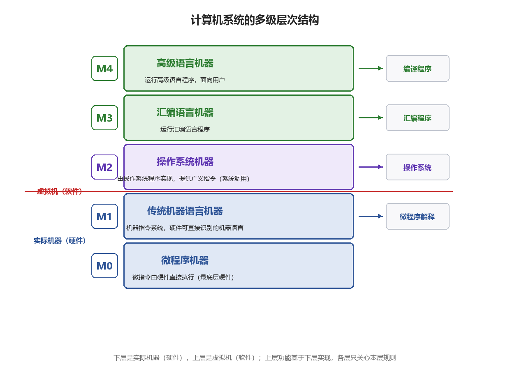

<i>图 1-1 计算机系统的多级层次结构</i>

### 4.计算机系统的工作原理

①“存储程序”工作方式

在程序执行前，将其包含的指令和数据预先加载到主存储器中，计算机自动逐条取出并执行

从主存中取指→对指令译码→取操作数→执行操作→将结果写回存储器

②从源程序到可执行文件

C语言必须经过编译与链接过程，转换为一系列低级机器指令，并按照特定格式封装成可执行目标文件，最终以而精致形式存储与磁盘中

预处理阶段：预处理器$cpp$处理源文件种以#开头的预处理指令，生成预处理后的C文件.$.i$

编译阶段：编译器$ccl$将$.i$翻译为汇编程序$.s$，其中每条语句以文本形式描述一条低级机器指令

汇编阶段：汇编器$as$将$.s$转换成机器语言指令，生成【可重定位目标文件$.o$】

链接阶段：链接器$ld$将$.o$与标准库$C$库种所需的函数惊醒链接，解析外部符号引用，最终生成完整的可执行文件，并保存到磁盘

> **⚠️ 【易错辨析】**  
> 一条指令的执行步骤为取指、译码、执行（含取操作数与写回）；取指后 PC 自动加 1，为下一条指令做准备  

> **📝 【补充】**  
> 源程序到可执行文件依次经过预处理、编译、汇编、链接；预处理处理 # 指令，编译生成汇编，汇编生成可重定位目标文件，链接合并库并解析外部符号后生成可执行文件  

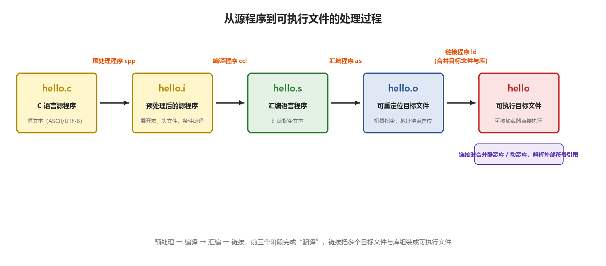

<i>图 1-2 源程序转换为可执行文件的过程</i>

### 5.计算机的性能指标

运算速度

①吞吐量和响应时间（包括CPU时间和等待时间）

②主频和CPU时钟周期

CPU时钟周期：机器内部注释中脉冲宽度，CPU的最小时间单位

时钟周期通常以相邻状态单元间组合逻辑电路的**【最大延迟时间】**为基准确定；在流水线结构中，则以**【指令流水线的每个流水段的最大延迟时间】**为准

主频（CPU时钟频率）：时钟周期的倒数，表示**【每秒包含的时钟周期数】**

③$CPI(Cycles Per Instruction)$：执行一条指令所需的时钟周期数

$IPS(Instructions Per Second)$：每秒执行多少条指令

$MIPS\left( Million Instructions Per Second \right)$：用于不同机器间的性能比较存在明显缺陷

④CPU执行时间（运行一个程序所花费的时间）

【CPU的性能取决于：指令条数、$CPI$、主频】

⑤$FLOPS(Floating-point Operations Per Second)$：每秒执行的浮点运算次数

> **⭐ 【大题考点】**  
> 性能计算是本章唯一常出的计算题，需掌握：CPU 执行时间 = 指令条数 × CPI × 时钟周期 = 指令条数 × CPI / 主频，主频 = 1 / 时钟周期  

> **⚠️ 【易错辨析】**  
> CPI 是执行一条指令所需的平均时钟周期数；MIPS = 主频 /(CPI × 10⁶)，用 MIPS 比较不同指令集存在明显缺陷  
> CPU 时间只计 CPU 真正运行的时间，不含等待 I/O 的时间；MFLOPS 衡量浮点运算能力  

> **📝 【补充】**  
> CPU 性能取决于指令条数、CPI、时钟周期三要素，分别与 ISA 及编译、CPU 组织、硬件工艺有关，三者相互制约  

# 第二章 数据的表示和运算

### 1.原码、补码、反码、移码

①原码表示法：最高为表示数的符号，零的表示不唯一

②补码表示法：计算机以补码的形式存储信息，**【无符号数只是在解释的时候有区别】**

补码表示法的加法和减法运算可通过加法器统一实现

$\text{正数的补码}=\text{原码，负数的补码}=\text{按位取反}+1$零的补码唯一

补码的运算：${\left[ A \right]}_{\text{补}}-{\left[ B \right]}_{\text{补}}={\left[ A \right]}_{\text{补}}+M-{\left[ B \right]}_{\text{补}}={\left[ A \right]}_{\text{补}}+{\left[ -B \right]}_{\text{补}} , M-{\left[ B \right]}_{\text{补}}={\left[ -B \right]}_{\text{补}}$

变形补码（双符号位补码表示）：00表示正数，11表示负数，左符号位为真正的符号位，右符号位用于一处判断

【模4补码$\ne $双符号位，模$n$补码只有一个符号位，而仅在$ALU$运算时，会将符号位复制到$ALU$的双符号位中】

③反码表示法：真值转换为补码的中间表示形式，零的表示不唯一、**【反码数值越大真值越大】**

④移码表示法：**【表示浮点数的解码，且用于表示整数】**。针织加上一个固定的偏置值实现整体右移${\left[ x \right]}_{\text{移}}=x+{2}^{n}$

零表示唯一、相同字长下与补码仅符号位不同、移码全0对应真值的最小值为$-{2}^{n}$、移码全1对应真值的最大值${2}^{n}-1$、**【移码保持真值的大小顺序，移码越大真值越大】**

> **📌 【考点考频】**  
> 本章是组成原理的重中之重，选择题与大题都高频，补码移码、IEEE754、定点乘除几乎年年出现  

> **⚠️ 【易错辨析】**  
> 原码与反码的 0 不唯一，补码与移码的 0 唯一；n+1 位补码范围为 −2ⁿ ~ 2ⁿ−1，比原码多表示一个最小负数 −2ⁿ  
> 正数的原码、反码、补码相同；移码只用于表示浮点数阶码，保持真值大小顺序，且与补码仅符号位相反  

> **📝 【补充】**  
> 移码 = 真值 + 偏置值；变形补码（双符号位）中 00 表正、11 表负，01 为正溢、10 为负溢，左符号位为真符号  

### 2.整型数据的类型转换

位截断：丢弃高位保留低位

位扩展：零扩展→无符号整数；符号扩展→有符号整数

> **⚠️ 【易错辨析】**  
> 长数转短数（截断）丢弃高位，可能溢出；短数转长数（扩展）时无符号零扩展、有符号符号扩展，值不变  
> 有符号数与无符号数互转时二进制位不变、只是解释方式改变，数值可能变化；无符号数没有符号位  

### 3.运算方法和运算电路

运算器：由算术逻辑单元$ALU$、移位器、状态寄存器、通用寄存器组等组成

基本功能包括：四则运算、逻辑运算、移位、求补等，核心为**【加法器】**

一位全加器$FA$：三个输入→两个加数和一个来自低位的进位；两个输出→本位和、向高位的进位；**【缩短进位传递路径】**是提升性能的关键

串行进位加法器：由多个全加器级联构成

并行进位加法器（先行进位加法器）：$n$个一位全加器被连接至一个$n$位【先行进位逻辑部件$CLA$不见】

带标志加法器

溢出标志$OF$→$OF={C}_{n}\oplus {C}_{n-1}$**【有符号加减的溢出判断】**

符号标志$SF$→$SF=$结果的最高有效位

零标志$ZF$

进位/结尾标志$CF$→**【无符号加减的溢出判断】**

> **⚠️ 【易错辨析】**  
> 全加器有三个输入（两个加数与低位进位）、两个输出（本位和与向高位进位）  
> 串行进位延迟随位数线性增加，先行进位 CLA 提前生成各位进位、延迟小但电路复杂  
> 溢出标志 OF 用于有符号运算，进位/借位标志 CF 用于无符号运算，判断对象不同  

> **📝 【补充】**  
> 标志位含 ZF 零标志、SF 符号标志（结果最高位）、OF 溢出标志、CF 进位/借位标志  

### 4.定点数的运算

移位运算：逻辑移位**【无符号整数】**、算术移位**【有符号整数】**→移出的高位于原符号位不同**【左移后符号位改变】**，则说明溢出

【算数右移与$C$语言的除法直接截断小数部分得到结果可能不同】

加减运算（字长为$n+1$）
$${\left[ A+B \right]}_{\text{补}}={\left[ A \right]}_{\text{补}}+{\left[ B \right]}_{\text{补}}\left( \mathrm{mod} {2}^{n+1} \right)$$

${\left[ A-B \right]}_{\text{补}}={\left[ A \right]}_{\text{补}}+{\left[ -B \right]}_{\text{补}}\left( \mathrm{mod} {2}^{n+1} \right)$减法时→被减数的补码于减数的负数补码进行相加

**【符号位与数值为一同运算，结果的符号位有运算自然得出】**

运算结果自动截断$n+1$位，高位进位被丢弃

溢出判别方法

①采用一位符号位：$V={A}_{s}{B}_{s}{S}_{s}+{A}_{s}{B}_{s}{S}_{s}$

②采用一位符号位+进位情况：$V={C}_{n}\oplus {C}_{n-1}$

③采用双符号位：$V={S}_{s1}\oplus {S}_{S2}$，01→正溢出，10→负溢出

> **⭐ 【大题考点】**  
> 溢出判断是高频小计算，三种方法都要会：单符号位比较、单符号位结合进位、双符号位判断  

> **⚠️ 【易错辨析】**  
> 逻辑移位用于无符号数、空位补 0；算术移位用于有符号数、空位按规则补符号位；左移可能溢出，右移损失精度  
> 只有有符号数才谈溢出，无符号数的越界表现为进位 CF  

> **📝 【补充】**  
> 加减统一为补码加法：A−B = [A]补 + [−B]补，符号位参与运算、高位进位自然丢弃；OF = 最高位进位 ⊕ 次高位进位  

### 5.加减运算电路

一套电路两种语义，减法时，【$Sub$控制信号作为最低位进位输入】

无符号数大小比较：零标志位$OF$及进/借位标志$CF$

有符号数大小比较：零标志位$OF$及符号标志$SF$及溢出标志$OF$

> **⚠️ 【易错辨析】**  
> 实现减法时把减数各位取反，并令最低位进位为 1，即得到 [−B]补  
> 无符号数大小比较看 ZF 与 CF，有符号数大小比较看 ZF、SF、OF  

### 6.定点数的乘法运算

**【符号位与数值为分别处理】**：乘积符号位→两个符号位进行异或；乘积的数值位→两个数值位的绝对值之积

硬件中的实现**【先运算后右移】**

$n$位乘法，需要用$2n$位暂存结果，最终保留低$n$位。若高位不全为0则说明溢出

①无符号整数的乘法**【存进位信息】**

初始化，控制逻辑计数器${C}_{n}=$位数→先运算→后右移→${C}_{n}--$

②有符号整数的乘法$Booth$**【无需存进位信息，但是乘数寄存器中有辅助位】**

初始化，辅助位置0，控制逻辑计数器${C}_{n}=$位数→先运算→右移→${C}_{n}—$

运算规则

乘数寄存器最低位$Y$和辅助位$P$相同时，+0

$Y$与$P$相异时，$Y\to 0$执行$P+{\left[ X \right]}_{\text{补}}$；$Y\to 1$执行$P-{\left[ X \right]}_{\text{补}}=P+{\left[ -X \right]}_{\text{补}}$

乘法的实现方式（$nbit$的无符号相乘）

①由$ALU$、移位器、寄存器、控制逻辑电路组成的乘法电路，需要$n$个时钟

②阵列乘法器（快速乘法器的一种）：一个时钟完成

③无乘法电路：使用代码的移位运算及加法运算实现→$bit=y\&1;x\ll =1$

> **⭐ 【大题考点】**  
> Booth（补码一位乘）是大题高频，需会逐步列部分积：初值为 0、设辅助位、按两位判断加减、再算术右移  

> **⚠️ 【易错辨析】**  
> 无符号乘法的符号位单独异或、数值用绝对值相乘，n 位乘 n 位得到 2n 位乘积  
> Booth 看乘数最低位与辅助位：00/11 加 0，01 加 [X]补，10 加 [−X]补，随后算术右移；无符号乘法需存进位，Booth 不存进位但有辅助位  

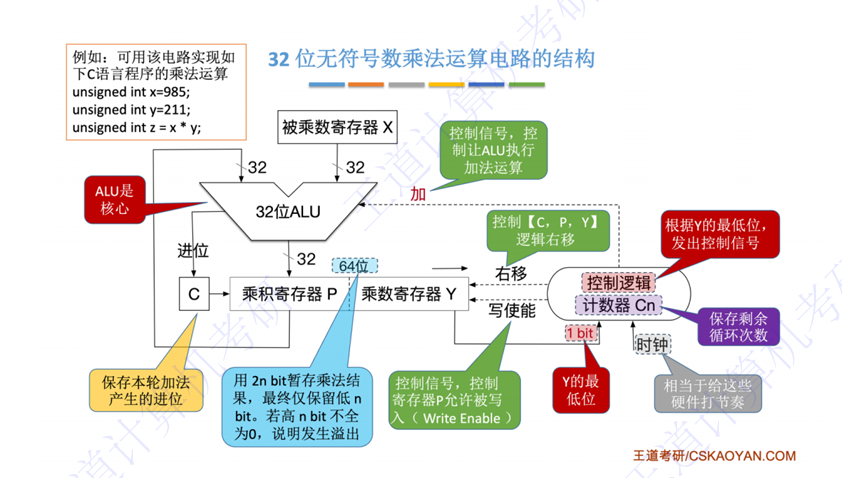

<i>图 2-1 32 位无符号数乘法运算器的逻辑结构</i>

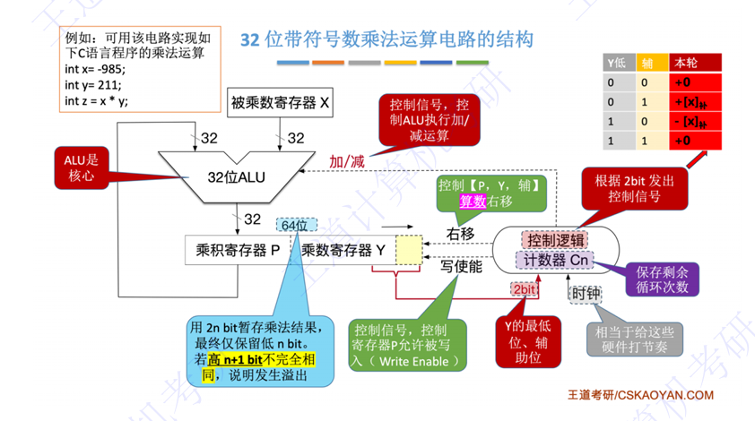

<i>图 2-2 32 位补码一位乘法（Booth）寄存器的逻辑结构</i>

### 7.定点数的除法运算

**【先左移再计算】**

无符号整数的除法

①初始化

**【被除数零扩展】**→余数寄存器$R$+余数/商寄存器$Q$、${C}_{n}=n$、除数寄存器$Y$

特殊情况：除数为0→直接停止→OS异常处理程序

&nbsp;&nbsp;&nbsp;&nbsp;&nbsp;&nbsp;&nbsp;&nbsp;&nbsp;&nbsp;|被除数|$\lt $|除数|，商=0，余数$=$被除数，不运算

②进行【$n+1$】轮处理：规则→$\left[ R \right]-\left[ Y \right]\ge 0$上商1，否则上0

第一轮特殊处理：直接上商，为1→溢出；为0→不溢出，【不保存商且${C}_{n}$不变】

第一轮的判断方法：

&nbsp;&nbsp;&nbsp;&nbsp;恢复余数法：$R-Y$→$R$，判断$R$是否为0；之后还原$R=0$，即执行$R+=Y$

&nbsp;&nbsp;&nbsp;&nbsp;不恢复余数法：第一轮不恢复余数，下一轮判断是否需要执行$R+=Y$

其余$n$轮循环处理：左移→最右用于上商；上商（进行加减运算）；${C}_{n}—$

③最终输出：$R$→余数、$Q$→商

有符号整数的除法

初始化和特殊情况与无符号整数除法基本一致

初始化：被除数符号扩展

特殊情况判断：对于单精度有符号位除法，当且仅当$min\div (-1)$才会溢出

进行【$n$轮处理】

上商规则

&nbsp;&nbsp;中间余数与减数符号位→相同执行减法、相异执行加法

&nbsp;&nbsp;$ALU$计算结果存入$R$，其符号位决定上商数→新旧相同则上1、相异则上0

&nbsp;&nbsp;**【上0时要恢复余数】**

结束状态：控制逻辑根据被除数和除数符号修改$Q$→异号取补码、同号直接输出

> **⭐ 【大题考点】**  
> 恢复余数法与不恢复余数法（加减交替法）是大题考点，需逐步列出余数与上商  

> **⚠️ 【易错辨析】**  
> 除法先左移再判断，与乘法先运算后右移相反；够减上商 1，不够减上商 0  
> 恢复余数法在余数为负时加回除数恢复；不恢复余数法不立即恢复，下一步改为加除数  

> **📝 【补充】**  
> 除数为 0 属异常；|被除数| < |除数| 时商为 0、余数为被除数  

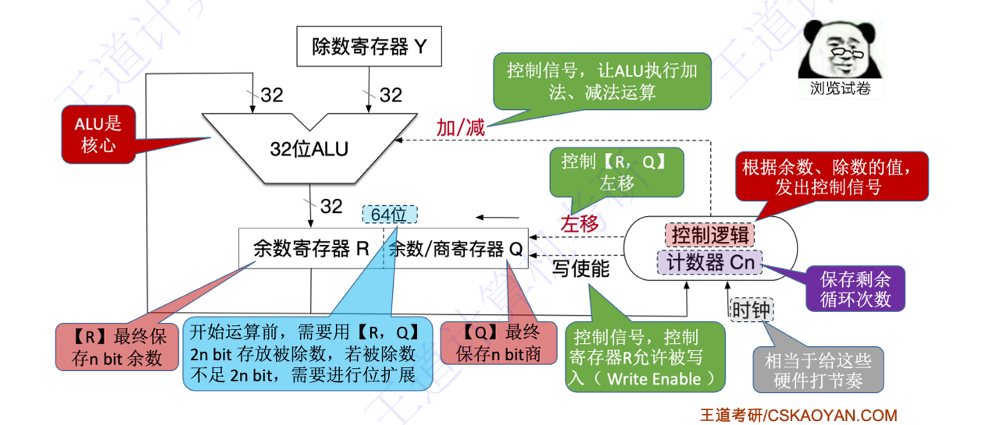

<i>图 2-3 32 位除法运算的逻辑结构</i>

### 7.浮点数的表示与运算

由符号、阶码**【偏置表示】**、尾数**【原码表示】**三个部分组成

$IEEE 754$标准的浮点数**【默认存储规格化小数，阶码不全相同】**

32位单精度格式：1+8+23

64位双精度格式：1+11+52

非规格化小数→阶码全0，$f\ne 0$、无穷→阶码全1，$f=0$、无定义→阶码全1，$f\ne 0$

规格化小数→阶码不全相同（小数点前的1省略）

阶码：用移码表示，规定偏置值→单精度127、双精度1023

将十进制真值转换成偏置值为$M$的移码步骤

①十进制数+偏置值$M$

②“无符号整数”转换成指定位数

浮点数的加减运算

①对阶：小阶码对大阶码→阶码小的，阶码进行加法，尾数相应右移**【尾数右移要保留3位小数】**

②加减运算

③规格化：右规阶码+1、左规阶码-1

④依据规则进行舍入

&nbsp;&nbsp;$GRS$，保护位$G$、舍入位$R$、粘滞位$S(\text{后面的所有值，全}0\to 0)$

&nbsp;&nbsp;就近舍入：$G==0$→直接舍去

&nbsp;&nbsp;&nbsp;&nbsp;&nbsp;&nbsp;&nbsp;&nbsp;&nbsp;&nbsp;&nbsp;&nbsp;$G==1\&\&R+S==1$→尾数$+1$

&nbsp;&nbsp;&nbsp;&nbsp;&nbsp;&nbsp;&nbsp;&nbsp;&nbsp;&nbsp;&nbsp;&nbsp;$G==1\&\&R\cdot S==0$→尾数为$1$则$+1$，否则舍弃

&nbsp;&nbsp;正向舍入、负向舍入、截断舍入

⑤溢出判断：阶码全1→无穷（上溢）、阶码全0→下溢（非规格化小数或机器零）

浮点数的加减运算的溢出判断

**【不以尾数溢出判断，取决于阶码是否上溢】**

上溢→**【先规格化，尾数置0】**、下溢→**【不规格化，阶码置0】**

下溢时，【阶码为00…001仍需要右规，但尾数$f$不变】，即下溢到非规格化区间，当$f$全0则为机器零

注意【$float\to int$直接截断小数部分，不会有舍入问题】

> **⭐ 【大题考点】**  
> IEEE754 表示与浮点加减是必考大题：十进制与浮点格式互转、对阶、规格化、舍入、溢出判断  

> **⚠️ 【易错辨析】**  
> 单精度为 1+8+23、双精度为 1+11+52；阶码用移码（偏置 127/1023），尾数用原码且隐含前导 1  
> 对阶时小阶向大阶看齐、尾数右移；浮点是否溢出看阶码而非尾数，阶码上溢为无穷、下溢为非规格化或机器零  
> 阶码全 0 表示非规格化数或零，阶码全 1 表示无穷或 NaN  

> **📝 【补充】**  
> 舍入依据保护位 G、舍入位 R、粘滞位 S，就近偶舍入看 GRS；左规阶码减 1 可多次，右规阶码加 1 通常一次  

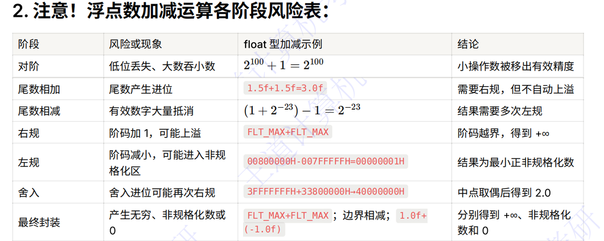

<i>图 2-4 浮点数加减运算各步骤及风险点</i>

### 8.真值用浮点数精确表示

**【数值→分数的形式】**，分母能被${2}^{n}$表示，则二进制小数能有限结束，除此之外还要判断能否用对应尾数位数表示

> **⚠️ 【易错辨析】**  
> 十进制小数化简后分母只含因子 2 且位数足够时，才能用二进制精确表示，如 0.1 无法精确表示  

### 9.数据的存储和排列

大端存储方式：便于人类阅读，高位字节→低地址

小端存储方式：便于机器阅读，低位字节→低地址**【机器从低地址向高地址处理】**

边界对齐存储方式：一个字/半字只需要访存1次；要求数据的存储地址必须是对齐值得整数倍

非边界对齐存储方式：一个字或半个字需要访存2次

> **⚠️ 【易错辨析】**  
> 大端方式把高位字节放低地址，小端方式把低位字节放低地址（x86 常用小端）  
> 边界对齐时数据地址是其长度的整数倍、一次访存可取；未对齐可能需要两次访存  

> **📝 【补充】**  
> 边界对齐以少量填充空间换取访存次数的减少  

# 第三章 存储系统

### 1.存储器的类别

按存储元件分类：半导体器件→DRAM、SRAM、此表面存储器、光存储器

按存取方式分类

①随机存取存储器RAM：主存或高速缓存

②顺序存取存储器：磁带

③直接存取存储器：兼具随机存取、顺序存取的特性→传统机械磁盘

④相联存储器：**【按内容进行存取】**，不是根据地址进行存取→快表TLB、路由表等小容量高速查找器件

按信息的可保存性：易失性存储器RAM、非易失性存储器ROM

若数据读出破坏存储单元信息→破坏性读出

若数据读出不破坏存储单元信息→非破坏性读出

> **📌 【考点考频】**  
> 本章与第二章并列最重要，Cache 映射/替换/写策略与计算、主存扩展、DRAM 刷新是选择与大题的高频点  

> **⚠️ 【易错辨析】**  
> RAM 为随机存取、SAM 顺序存取（磁带）、DAM 直接存取（磁盘先寻道后顺序）；相联存储器按内容访问，如 TLB  
> SRAM 不需刷新、用作 Cache；DRAM 需刷新、用作主存；RAM 易失，ROM、Flash、磁盘、光盘非易失  

### 2.主存储器的组成和基本操作

$MDR$的位数$=$数据线宽度、$MAR$位数$=$地址线得到位数

> **⚠️ 【易错辨析】**  
> MAR 位数决定可寻址单元数，MDR 位数等于存储字长；总容量 = 2^(MAR 位数) × MDR 位数  

> **📝 【补充】**  
> MAR、MDR 现代集成在 CPU 内，但属于存储器接口  

### 3.存储器的而层次化结构

关键层级：$Cache-$主存层→缓解CPU与主存速度不匹配问题、主存$-$辅存层→解决存储容量不足问题

上一层存储器作为下一层的高速缓存。当CPU访问数据按照$Cache$→主存→辅存的顺序主机查找

> **⚠️ 【易错辨析】**  
> Cache—主存层解决速度问题、由硬件管理且对程序员透明；主存—辅存层解决容量问题、由硬件与操作系统共同管理  
> 层次越靠上速度越快、容量越小、每位价格越高，反之亦然  

> **📝 【补充】**  
> 层次结构以程序局部性原理为基础，目标是速度接近最快层、容量接近最大层、价格接近最便宜层  

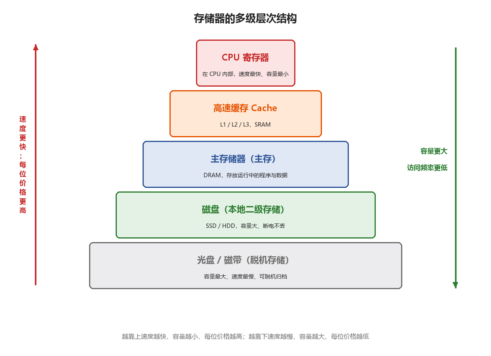

<i>图 3-1 存储器的多级层次结构</i>

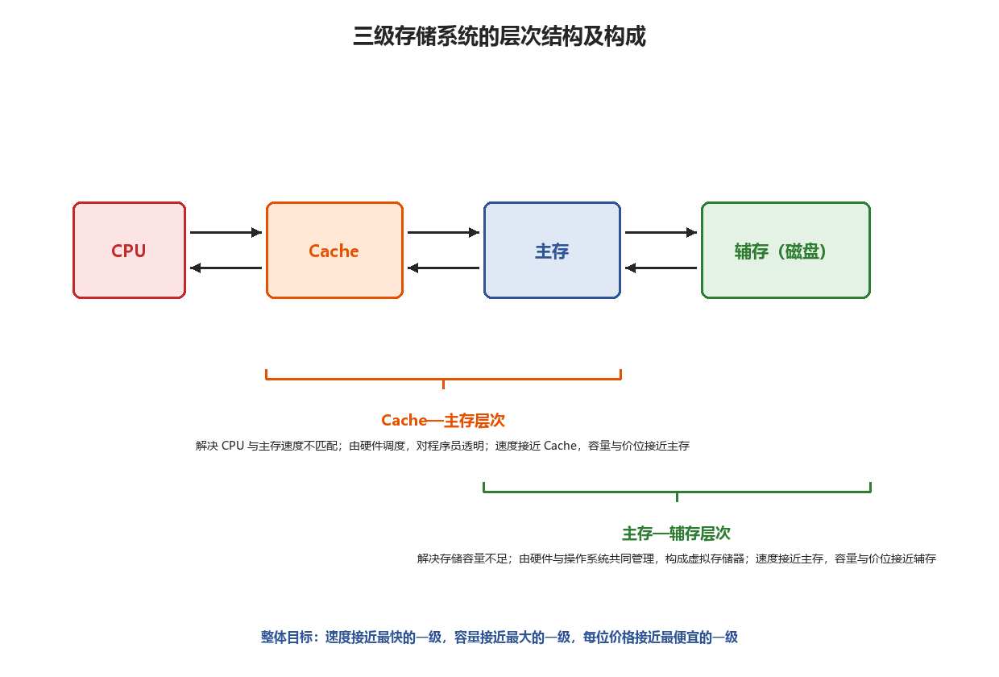

<i>图 3-2 三级存储系统的层次结构及构成</i>

### 4.存储器的主要性能目标

存储周期：存储器进行连续两次独立的读/写操作所需要的最小时间间隔

【存取时间$\ne $存储周期，存贮周期$\gt $存取时间】，每次读/写操作后，存储器需要一定时间恢复内部状态。对于破坏性读出的存储器，读出后需要再生数据

存储器带宽：可被组织成多模块结构，多个模块并行工作进而提升总带宽

> **⚠️ 【易错辨析】**  
> 存取时间是一次读写所需时间，存取周期 = 存取时间 + 恢复时间，故存取周期大于存取时间  
> 带宽为单位时间内存取的数据量；破坏性读出的存储器读出后需再生，再生时间计入存取周期  

### 5.半导体随机存取存储器

分为SRAM（静态RAM）、DRAM（动态RAM）。贮存主要采用DRAM、$Cache$主要采用SRAM

SRAM：双稳态触发器（六晶体管MOS）、行列地址同时送，集成度低

DRAM：利用栅极电容上的电荷存储信息，集成度高

存储芯片的组成

①存储体（存储矩阵）：存储单元的集合，通过行选择线、列选择线共同选中目标单元

②地址译码器：单译码法→仅使用一个行译码器，同一行中所有存储单元的字线相连，构成一个字；双译码法→通过行与列的交叉点唯一确定一个存储单元

③$I/O$电路：控制被选中存储单元的读/写，具有放大信号的作用

④片选控制线：单个存储芯片容量有限，采用多个芯片组合拓展。

⑤读/写控制线

DRAM芯片的技术

①地址引脚复用技术：分时复用传送行地址和列地址。芯片内部采用三维结构

②刷新机制与阵列设计优化

芯片内部集成一个刷新计数器、**【刷新按行刷新】**→行数越少刷新开销月底

DRAM数据只能维持2s，刷新一次占用一个读/写周期，**【刷新发生在译码阶段】**

刷新方式：分散刷新→每存取一次刷新一次**【改变存取周期】**

&nbsp;&nbsp;&nbsp;&nbsp;&nbsp;&nbsp;&nbsp;&nbsp;&nbsp;&nbsp;集中刷新→有一段专门刷新的**【死区】**

&nbsp;&nbsp;&nbsp;&nbsp;&nbsp;&nbsp;&nbsp;&nbsp;&nbsp;&nbsp;异步刷新→2ms内每行刷新一次→**【死时间】**

③缓存机制与突发传输：内部设有一个行缓冲器**【由SRAM实现】**，用于缓存被选中行中所有列的数据，其容量等于一行中所有存储单元的数据总量，即【容量$=$列数$\times $每个存储单元的位数】

同步DRAM（SDRAM）：读写操作与系统时钟同步。连续访问**【同一行/页】**的数据可以实现突发传输，显著减少甚至避免插入等待状态。

异步DRAM：CPU发出地址和控制信号后，**【必须等待一段不确定的延迟时间】**才能获得数据或完成写入，在此期间CPU不断轮询存储器的状态信号

> **⭐ 【大题考点】**  
> DRAM 刷新计算（刷新周期、死区、每行刷新间隔）可出小计算题  

> **⚠️ 【易错辨析】**  
> SRAM 靠双稳态触发器、不需刷新、集成度低；DRAM 靠电容存储、需刷新、集成度高  
> DRAM 地址引脚复用，行、列地址分两次传送；刷新按行进行，与个别单元访问无关  
> 三种刷新方式中，集中刷新有死区，分散刷新拉长周期、无明显死区，异步刷新最常用、死区短  

> **📝 【补充】**  
> SDRAM 与系统时钟同步、支持突发传输，内部行缓冲由 SRAM 实现、缓存一整行数据  

### 6.非易失性存储器

ROM属于非易失性存储器，按照制造工艺和可编程性可分为

①掩模式ROM（MROM）②一次可编程ROM（PROM）③可擦除可编程ROM（EPROM）

EPROM：紫外线擦除，只能擦除整片芯片

EEROM：电擦除，每次擦除一行

Flash存储器（闪存）：早期BIOS固化在MROM或EPROM中无法更新，现在BIOS在Flash存储器中

支持电擦除和在线重写、读取速度接近RAM、写入速度较慢

固态硬盘SSD：基于闪存构建的存储设备，由控制单元存储单元（闪存阵列）组成

> **⚠️ 【易错辨析】**  
> MROM 为掩模式，PROM 一次可编程，EPROM 靠紫外线整片擦除，EEPROM 电擦除可按字节，Flash 按块电擦除  

> **📝 【补充】**  
> BIOS 现存放于 Flash（早期在 MROM/EPROM），固态硬盘 SSD 基于闪存构建  

### 7.多模块存储器

**【同一个存储体的读写必须间隔一个存取周期】**

分为连续编制和交叉编制两种结构

①连续编制：模块号+地址→即一个存储体内的地址是连续的

存取方式是连续的、本质上还是**【顺序存储器】**

②交叉编制（低位交叉编制）：地址+模块号→即一个存储体内的地址是不连续的，程序或数据块在物理上是**【交叉存放的】**

可采用轮流启动、同时启动两种方式

轮流启动：流水线方式

同时启动：所有存储块一次并行读/写的位数=存储器数据总线宽度，多个存储体并行读取

> **⭐ 【大题考点】**  
> 低位交叉轮流启动的时间与带宽计算是高频点：连续读取 m 个字的时间 = T + (m−1)τ，其中 τ = T/m  

> **⚠️ 【易错辨析】**  
> 连续编址（高位交叉）体号在高位、相邻地址同体，主要用于扩容、难以并行提速  
> 交叉编址（低位交叉）体号在低位、相邻地址分布在不同体，可流水并行、提高带宽  
> 同一个存储体的两次访问必须间隔一个存取周期 T  

> **📝 【补充】**  
> 同时启动时 m 个体一次并行读出 m 个字（受总线宽度限制），轮流启动以流水线方式工作  

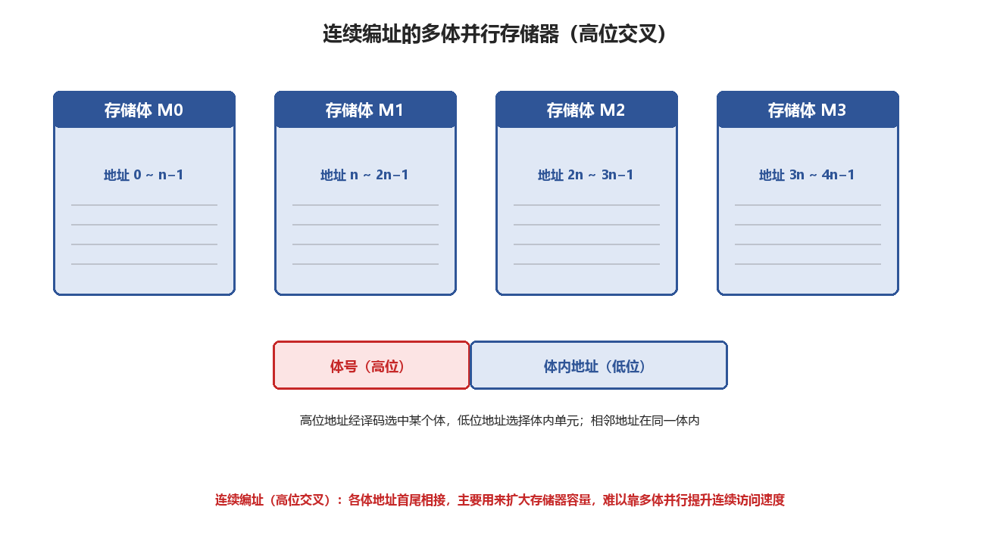

<i>图 3-3 连续编址的多体并行存储器</i>

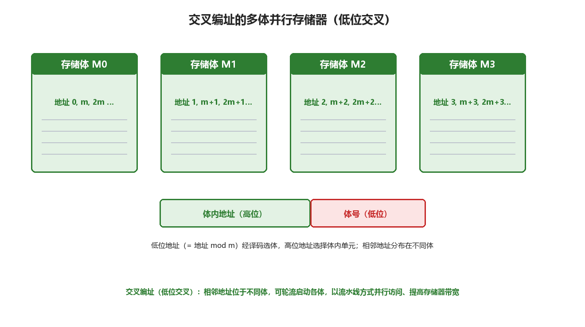

<i>图 3-4 交叉编址的多体并行存储器</i>

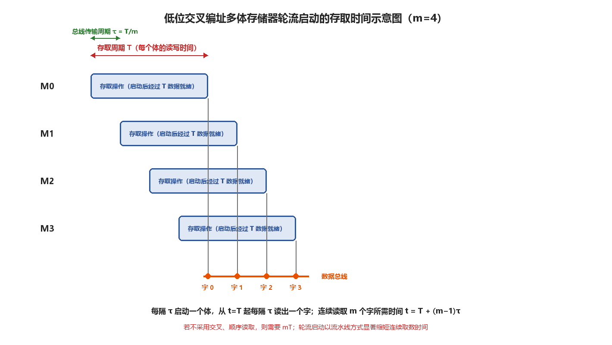

<i>图 3-5 低位交叉轮流启动的存取时间示意图</i>

### 8.不同类型的存储器及特点

单体多字存储器：可能用到多个缓冲寄存器

多端口存储器（显卡、显存、多设备）：同一个存储体**【使用多套读写电路】**、扩容难、并行访问、类似生产者-消费者模式、随机访问无冲突

多体低位交叉存储器：连续地址访问可采用流水线访问、**【随机访问性能差】**、**【随机访问冲突：同一个存储体的读取必须间隔一个存取周期】**、无法支持独立端口**【所有访问共享一套总线】**

> **⚠️ 【易错辨析】**  
> 单体多字存储器按一个地址同时读出多个字，多端口存储器配备多套读写电路、可被多设备访问但扩容困难  
> 低位交叉存储器随机访问性能较差、可能访问同体，且所有访问共享同一套总线  

### 9.主存容量的扩展

位扩展：**【增加存储字的长度】**→并联多个芯片

连接方式：一个地址总线=一个字

字扩展：**【增加存储单元数量（扩大地址空间）】**→串联多个芯片，使用译码器选择芯片，同一时刻只能选中一个芯片

字位同时扩展：同一时刻选择一组芯片

> **⭐ 【大题考点】**  
> 存储器与 CPU 的连接、地址空间分配、片选译码、所需芯片数计算是大题高频点  

> **⚠️ 【易错辨析】**  
> 位扩展字数不变、只增字长，地址线与 CS、WE 并联，数据线分别接各位  
> 字扩展字长不变、只增字数，地址低位与数据线并联，高位经译码器选片、同一时刻只选一片  

> **📝 【补充】**  
> 芯片数 = 总容量 / 单片容量；字位同时扩展时先按位扩展成组、再在组间按字扩展译码  

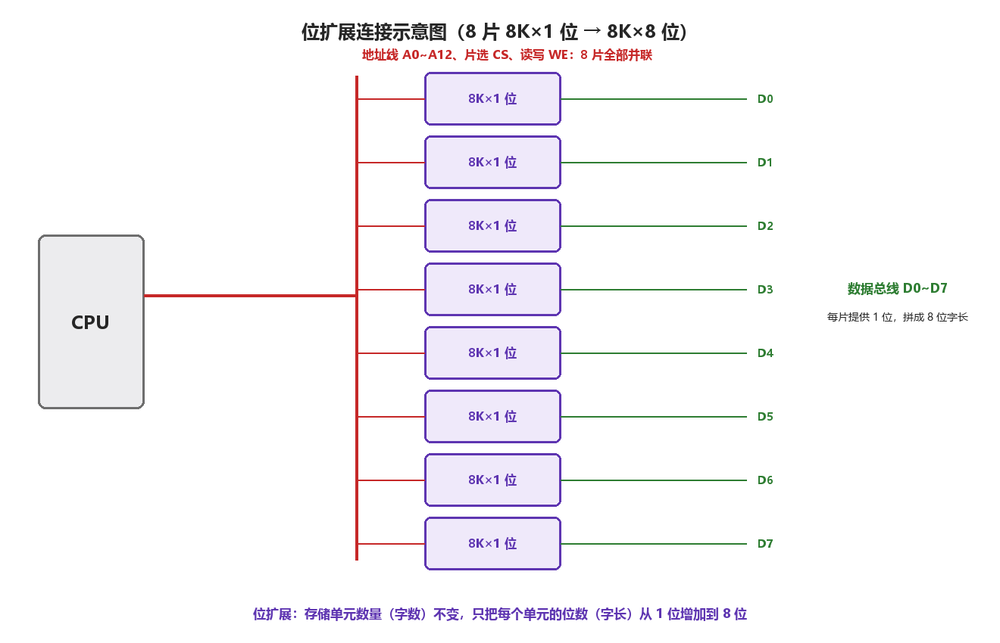

<i>图 3-6 位扩展连接示意图</i>

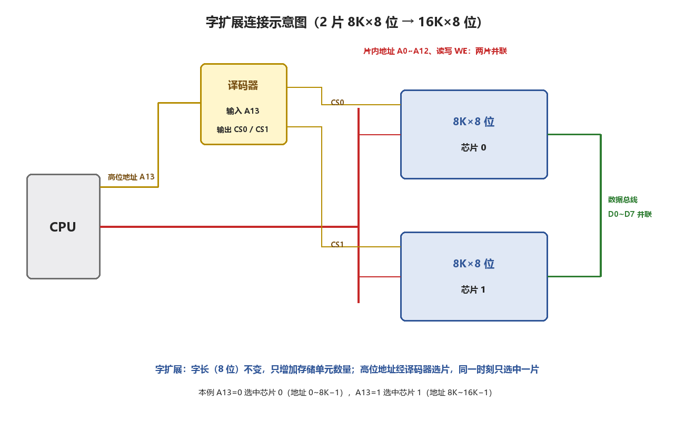

<i>图 3-7 字扩展连接示意图</i>

### 10.磁盘存储器

磁盘存储器的组成

由磁盘驱动器、磁盘控制器、盘片组成

磁盘驱动器：驱动磁盘旋转并通过磁头在盘面上进行读写

磁盘控制器：磁盘驱动器与主机之间的接口，负责接收并解析CPU命令，向磁盘驱动器发送控制信号并监控运行状态

磁盘高速缓存（Disk Cache）：在内存中靠皮有一部分空间暂存待写入磁盘的数据

磁盘以**【“簇”】**为单位进行写操作

磁盘记录原理：通过电磁实现数据的读/写操作

编码方式：将二进制数据序列转换为磁层中对应的磁化翻转状态序列

磁盘性能指标

①记录密度

②磁盘容量：非格式化容量、格式化容量→预留扇区间隙、同步字段、备用扇区等

③响应时间与存储时间

响应时间=排队延迟+控制器时间+寻道时间**【主要】**+旋转等待时间+数据传输时间

存取时间=寻道时间+旋转等待时间+数据传输时间

磁盘阵列

RAID独立冗余磁盘阵列：多个独立的物理磁盘组合成一个逻辑磁盘，数据在多个物理攀上交叉分割存储并并行访问

RAID0：无冗余、无校验

RAID1：镜像磁盘阵列**【牺牲一半空间，两个磁盘同步读和写】**

RAID2：海明码纠错

RAID3：位交叉奇偶校验

RAID4：块交叉奇偶校验

RAID5：无独立校验盘的分布式奇偶校验磁盘阵列

> **⭐ 【大题考点】**  
> 磁盘容量、平均存取时间、数据传输率的计算常出大题  

> **⚠️ 【易错辨析】**  
> 存取时间 = 寻道时间 + 旋转延迟 + 传输时间，平均旋转延迟为转半圈的时间；数据传输率 = 每磁道容量 / 转一周时间  
> 磁盘属于直接存取而非随机存取，以簇为写入单位；格式化容量小于非格式化容量  

> **📝 【补充】**  
> RAID 中 0 为无冗余条带、1 为镜像、2 用海明码、3 为位级校验、4 为块级校验、5 为分布式校验（较常用）  

### 11.固态磁盘

基于闪存技术的存储设备，**【读/写操作以页为单位，擦除操作以块为单位】**

随机写入速度慢→擦除耗时较长、**【修改一个已有数据的页，必须先复制到新的块中再写入】**

磨损均衡

①静态磨损均衡（高级）：定期扫描，将高磨损块中的有效数据迁移到低磨损块中，高磨损块以读为主

②动态磨损均衡：优先选择擦写次数较少的空闲块写入

> **⚠️ 【易错辨析】**  
> 固态硬盘读、写以页为单位，擦除以块为单位，不能原地改写、修改前需先擦除块，故随机写入较慢  

> **📝 【补充】**  
> 磨损均衡分为静态与动态，用于均匀各块擦写次数、延长使用寿命  

### 12.程序的局部性原理

时间局部性：当前访问的某条指令或数据，在不久的将来可能会被再次访问

空间局部性：当前访问的存储单元，其附近的存储单元在不久的将来可能被再次访问

> **⚠️ 【易错辨析】**  
> 时间局部性指同一单元不久后可能再次被访问（如循环、栈），空间局部性指相邻单元可能被访问（如顺序执行、数组）  

> **📝 【补充】**  
> 局部性原理是 Cache 与虚拟存储器层次能够成立的基础  

### 13.Cache的基本工作原理

Cache的访问过程**【Cache的缺页完全由硬件实现，无需操作系统干预】**

每次需要从主存取指令或读/写数据，先访问Cache→命中则直接读取、未命中（Cache缺失）→主存中命中，则调入Cache（Cache满→替换算法）、未命中（缺页，操作系统执行缺页操作）

> **⚠️ 【易错辨析】**  
> Cache 缺失的处理完全由硬件完成、无需操作系统介入；缺页（虚存）才由操作系统处理  
> 命中条件为有效位等于 1 且标记 Tag 相等  

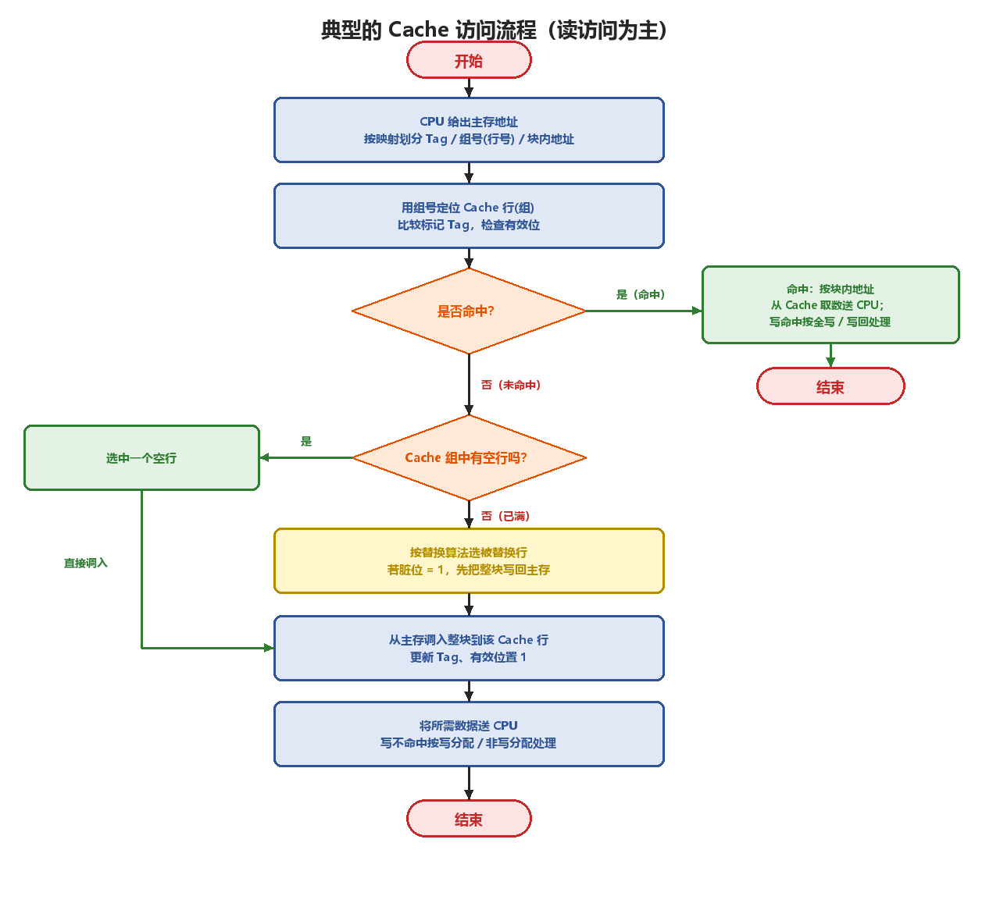

<i>图 3-8 典型的 Cache 访问流程</i>

### 14.Cache和主存的映射方式

Cache和主存有三种映射方式

Cache的地址结构

有效位+脏位+$(LRU\text{位})({log}_{2}\text{组内块数})$+标记位+$(Cache\text{行号}/Cache\text{组号})$+块内地址

①直接映射（类似于除留余数法）→块冲突概率最高、**【无需替换算法，直接替换】**

主存地址结构：标记+Cache行号+块内地址

**【通过比较主存的标记位与Cache中的标记位判断Cache是否命中】**

②全相联映射→主存中每一块可存放在Cache中的任意位置

主存地址结构：标记+块内地址

**【每次Cache命中的判断都要遍历Cache的所有行】**

查找过程是按内容访问的存取方式、因此属于相联存储器

③组相联映射

每组包括$r$行，称为$r$路组相联映射→$r$越大，块冲突概率越小

**【组间直接映射、组内全相联映射】**

主存地址结构：标记+组号+块内地址

> **⭐ 【大题考点】**  
> 三种映射的地址结构划分，以及 Tag、行号、组号、块内地址的位数计算是必考内容  

> **⚠️ 【易错辨析】**  
> 直接映射中主存块只能放入固定行、冲突率最高、无需替换算法；全相联可放任意位置、冲突最低但需比较全部行、成本高  
> 组相联为组间直接映射、组内全相联；直接映射地址为 Tag+行号+块内地址，全相联为 Tag+块内地址，组相联为 Tag+组号+块内地址  

### 15.Cache中的主存块替换算法

①随机算法$RAND$：随机替换

②先进先出算法$FIFO$

③最近最少使用$LRU$：基于局部性原理，优先替换最近最久未被访问的Cache行

每组Cache维护一组计数器【$LRU$替换位】，记录各Cache行的**【相对访问顺序】**

$LRU$计数器的值：记录最近访问的排名→最近访问的为第0名、替换$LRU$计数器值最大的Cache行，**【存在抖动现象】**

④最不经常使用$LFU$：替换一段时间内累计访问次数最少的Cache，替换时选择计数值最小的行，每次访问则计数器+1

> **⚠️ 【易错辨析】**  
> RAND 随机替换；FIFO 先进先出、不利用局部性且可能出现 Belady 异常  
> LRU 替换最近最久未访问的行、基于局部性、效果较好但需计数器或栈；LFU 替换累计访问次数最少的行  

> **📝 【补充】**  
> 直接映射位置唯一，不需要替换算法  

### 16.Cache的一致性问题

Cache写命中

①全写法（直写）：同时写入主存和Cache**【主存与Cache数据始终一致，无需写回】**

在主存和CPU之间通常设置一个**【写缓冲，可能饱和溢出】**

②写回法：只写入Cache，**【仅在该块被替换时写回主存，通过脏位判断被替换主存块是否需要写回】**

Cache写不命中

①写分配法：将数据写入主存，**【再将主存块调入Cache】**

②非写分配法：直接写入主存，不将数据调入Cache

> **⭐ 【大题考点】**  
> 写策略的组合及一致性判断常考：写回法常配合写分配，全写法常配合非写分配  

> **⚠️ 【易错辨析】**  
> 全写法（写直达）同时写 Cache 与主存、一致性好但速度慢、需写缓冲；写回法只写 Cache、置脏位、替换时才写回主存  
> 写分配在未命中时先把主存块调入 Cache 再写；非写分配直接写主存、不调入 Cache  

### 17.Cache容量的计算

Cache容量=（每行标记信息位数+每行数据位数）$\times $ Cache总行数

标记信息位=有效位+脏位+$(LRU\text{位})$+标记位

> **⭐ 【大题考点】**  
> Cache 总容量（含标记与控制位）的计算常考  

> **⚠️ 【易错辨析】**  
> 数据容量 = 行数 × 每行数据位数；总容量 = 行数 ×（数据位 + 有效位 + 脏位 + Tag 位 + 替换位）  
> 注意题目问的是数据容量，还是包含标记信息的总容量  

> **📝 【补充】**  
> 块内地址位数为 n 时，块内可寻址 2ⁿ 个单元  
> 字节编址下每单元 1B，故 Cache 块大小 = 2ⁿ B（数据位为 2ⁿ×8 bit），按字编址时再乘以字长字节数  
> Cache 行由标记信息位（Tag、有效位、脏位、替换位）与一个数据块构成；主存地址中的块内地址字段位数决定数据块大小  

### 18.Cache的应用

①分离Cache：将指令Cache和数据Cache分开→避免流水线执行时发生冲突

②同一Cache：在流水线执行时，取指部件和执行部件容易发生冲突

③多级Cache：写回+写分配法，距离CPU最近的Cache采用分离Cache

> **⚠️ 【易错辨析】**  
> 指令 Cache 与数据 Cache 分离可避免流水线冲突；多级 Cache 中 L1 常分离、L2 多统一  

### 19.虚拟存储器

页式虚拟存储器：页表，一个CPU维护一个页表基址寄存器

段式虚拟存储器：段表，一个CPU维护一个段表基址寄存器

段页式虚拟存储器：一个程序→一个段表，每一段→一个页表，一个CPU维护一个段表基址寄存器、**【没有页表基址寄存器】**

虚拟地址=段号+段内页号+页内地址

段表项：存储了段长、页表地址

TLB缺失、Cache缺失、Page缺失（主存缺失）

> **⚠️ 【易错辨析】**  
> 页式大小固定、有内部碎片无外部碎片；段式按逻辑划分、有外部碎片、便于共享与保护；段页式需多次查表  
> TLB 是页表的高速缓存（相联查找），TLB 命中可加速地址转换；一次访问可能出现 TLB 缺失、Cache 缺失、Page 缺失  
> TLB 命中指虚页号匹配且有效位为 1，此时页面必在内存，故 TLB 命中一定不会缺页；页表（慢表）的存在位表示页面是否在内存，页面换出时会同步把 TLB 对应表项有效位置 0  
> 多级页表中顶级页表（页目录）只有一个、必须常驻内存，其物理地址存于顶级页表基址寄存器（如 CR3），否则地址翻译失去起点；下级页表可按需建立、调入  

> **📝 【补充】**  
> 完整访问流程为：虚拟地址 → TLB（属于 MMU 的一部分）→ 页表 → 物理地址 → Cache → 主存；TLB 机构实现地址转换、得到物理地址，Cache 机构根据物理地址实现数据存取  

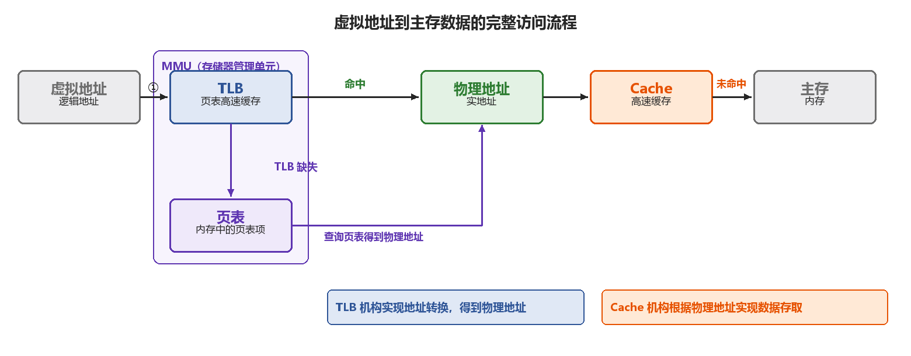

<i>图 3-9 虚拟地址到主存数据的完整访问流程</i>

### 20.虚拟存储器与Cache比较

Cache→解决CPU与主存之间速度不匹配的问题、由**【硬件独立实现】**

虚拟存储器→解决主存容量问题、由硬件+操作系统(主存缺页时)实现

> **⚠️ 【易错辨析】**  
> Cache 全由硬件实现、块小、解决速度问题；虚存由硬件与操作系统共同实现、页大、解决容量问题  
> Cache 缺失由硬件处理，缺页由操作系统（软件）处理  
> 内存块（Cache 块）不等于内存页，物理地址 = 标志 +（行号/组号）+ 块内偏移量 → 标记+有效位+数据位（Cache 块大小），而块内地址还可分为块内字选择与字节选择，字节选择位数由访存指令的数据宽度决定  
> Cache 中存储的位数与物理地址长度无关、页表项长度与虚拟地址长度无关  

### 21.Cache的性能影响因素

主要由命中率决定

①映射方式

②Cache容量：越大命中率越高

③块大小（Cache行大小）：块小难以利用局部性原理、**【块大会降低有效容量并增加缺失损失】**→块大小要适中

Cacche级数、指令/数据Cache分离、主存-总线-Cache-CPU的架构也会影响性能

> **⭐ 【大题考点】**  
> 平均访问时间 AMAT = 命中时间 + 缺失率 × 缺失代价，可出计算题  

> **⚠️ 【易错辨析】**  
> 块过小难以利用局部性，块过大降低有效容量、增加缺失代价，块大小要适中；容量增大命中率提高但成本与命中时间上升  

> **📝 【补充】**  
> 映射方式、Cache 容量、块大小、Cache 级数、指令数据分离等都会影响性能  
> Cache 缺失有三类来源：冷缺失（强制缺失，第一次访问某块）、容量缺失（Cache 装不下工作集，块被换出后再次访问）、冲突缺失（直接映射/组相联下多块争用同一行或同一组），数缺失次数时按这三类区分  
> 指令执行的缺失判断（与缺页判断类似）：初始为空的 Cache，每第一次访问一个新的主存块发生一次冷缺失，整块调入后块内后续指令命中；分析时按指令地址把各条指令归入它所在的主存块，逐块统计，每个块首次被取指计一次缺失、块内其余指令命中，前提是该块没有被替换出去  
> 访问数组的缺失判断（与缺页判断类似）：先看数组首地址是否与块边界对齐、有无偏移，不对齐时元素会跨块、首块只装部分元素；再由块大小与元素大小确定一个块能放几个元素，每进入一个新块第一次访问缺失、块内后续元素命中；遍历顺序影响很大，行优先连续访问缺失少，列优先且一行宽度不小于一个块时可能每次都缺失；循环重复访问时块仍在 Cache 中则命中，装不下或映射冲突会再产生容量缺失、冲突缺失  

# 第四章 指令系统

### 1.指令集体系结构ISA

规定了机器级程序的格式

ISA规定的内容各主要包括

①指令格式、寻址方式、操作类型，以及各操作数的个数、类型和寻址约束

②操作数的数据类型，**【大端存储还是小端方式存储】**

③程序可访问的寄存器编号、数量和位数，存储空间的大小及编址方式

④程序员可见的控制状态：程序计数器PC、条件码的定义与行为等

> **📌 【考点考频】**  
> ISA 是软硬件的交界面，选择题常考其规定的内容，以及哪些对机器级程序员可见  

> **⚠️ 【易错辨析】**  
> ISA 规定指令格式、寻址方式、操作类型、操作数个数与类型、寄存器、数据类型与大小端、编址方式、PC 与条件码等；具体怎么实现（微体系结构）对程序员透明，不属于 ISA  

### 2.指令的基本格式

操作码字段+地址码字段

①零地址指令：无显式地址→无需操作数的指令、**【用于堆栈计算机的运算指令】**

②一地址指令：单操作数指令、累加器型双操作数指令**【ALU隐含一个操作数】**

③二地址指令：操作码+目的地址+源地址

**【四次访存】**：取指（1次）+访问A1，A2（两次）+存结果（1次）

③三地址指令：操作码+两个数据地址+**【存放地址】**

**【四次访存】**

定长操作码格式：操作码位数固定

扩展操作码指令格式**【定长指令字结构+操作码】**：操作码的长度随地址码减少而增加

设计规则**【前缀编码】**

①不允许短操作码成为长操作码的前缀

②两个指令的的操作码一定不能重复

【每一组的前$k$位用于区分不同操作码的状态】

> **⭐ 【大题考点】**  
> 扩展操作码（定长指令字、操作码随地址码减少而扩展）的编码与指令条数计算，是本章最高频的大题  
> 按地址结构数访存次数：取指 1 次，再加上读各源操作数、写结果的访存次数，寄存器操作数不访存  

> **⚠️ 【易错辨析】**  
> 二地址指令两个操作数都在主存时共 4 次访存：取指 1、读 A1 与 A2 共 2、存结果 1；若操作数在寄存器，相应次数要扣除  
> 扩展操作码属于前缀编码，短操作码不能是长操作码的前缀，各操作码不能重复；地址码字段越少、可表示的操作码条数越多  

> **📝 【补充】**  
> 指令由操作码字段与地址码字段构成，按显式地址个数分为零地址、一地址、二地址、三地址；零地址可用于堆栈计算机，一地址的 ALU 可隐含累加器操作数  

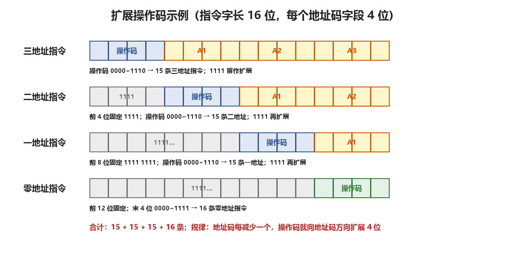

<i>图 4-1 扩展操作码示例</i>

### 3.指令的类型

数据传送指令、算数和逻辑运算指令、移位操作、顺序控制指令**【即跳转指令】**、输入输出指令、CPU控制指令**【内核态使用】**

> **⚠️ 【易错辨析】**  
> 指令按功能分为数据传送、算术与逻辑运算、移位、顺序控制（转移）、输入输出、CPU 控制等；CPU 控制指令一般只在内核态使用，归类题常考  

### 4.寻址方式

指令寻址：顺序寻址、跳跃寻址→绝对转移、相对转移

数据寻址

指令格式：操作码+**【寻址特征】**+形式地址$A$

有效地址$EA$→真实地址

常见的数据寻址方式

①隐含寻址：操作数隐含在特定寄存器中

②立即数寻址：$\# $表示立即寻址

③直接寻址

④间接寻址：形式地址指向一个存储单元，存储单元中存放$EA$

⑤寄存器寻址：形式地址指向一个寄存器，寄存器中存放操作数

⑥寄存器间接寻址：形式地址指向一个寄存器，寄存器中存放$EA$

⑦堆栈寻址：存储器（或寄存器组）中一块按照后进先出原则管理的特定存储区，地址由一个【堆栈指针$SP$】的特定寄存器指出。

可分为两类：硬堆栈→由高速寄存器构成、软堆栈→主存中划分一段区域实现

（类似于磁盘高速缓存的两种实现方式：硬件实现或划分特定区域→主存内部划分缓冲区）

偏移寻址【起点不同，但都是与形式地址$A$相加】

⑧相对寻址：**【转移类指令，重定位、共享代码→分段存储，一段代码在程序内浮动】**

$EA=(PC)+A$→即$PC$的值与形式地址相加得到真实地址$EA$

【注意】计算转移目标地址时，需注意程序计数器 $PC$ 中保存的是**字地址还是字节地址**；若为字地址，**要转换成字节地址**（MIPS 按字节编址，$PC$ 存字节地址，顺序执行时 $PC\leftarrow PC+4$；相对寻址的偏移量以字为单位，需**×4（左移2位）**后再与 $PC$ 相加）

⑨基址寻址：**【有利于多道程序设计（并发）、整段代码在主存中浮动】**

$EA=\left( BR \right)+A$→将基址寄存器中的值与形式地址$A$相加得到真实地址

$BR$可以是专用地址寄存器也可以是通用寄存器

**【基址寄存器的内容由操作系统决定，程序员只可以选择哪个寄存器作为基址寄存器，但存放的内容不可更改→页表/段表基址寄存器】**

⑩变址寻址：**【灵活的数据访问→数组的实现】**

$EA=\left( IX \right)+A$→将变址寄存器$IX$的内容与指令中的形式地址$A$相加

$IX$可以是专用的变址寄存器或指定的通用寄存器**【程序员可更改存放内容】**

可扩大寻址地址

> **⭐ 【大题考点】**  
> 给出寻址方式与形式地址，计算有效地址 EA、寻址范围与访存次数，是高频大题  

> **⚠️ 【易错辨析】**  
> 立即寻址（操作数在指令中）、寄存器寻址（操作数在寄存器）均不访存；直接寻址访存 1 次，寄存器间接寻址访存 1 次，间接寻址需多次访存  
> 基址与变址要分清：基址寻址的基址寄存器内容由操作系统给定、程序员不可改，形式地址是偏移量，利于多道程序与整段重定位；变址寻址的变址寄存器内容程序员可改，形式地址是基准，适合遍历数组  
> 相对寻址 EA =（PC）+ 形式地址，形式地址是补码偏移、可正可负，用于转移指令与段内浮动；注意取指后 PC 已自动指向下一条指令  
> 指令寻址分顺序寻址与跳跃寻址；数据寻址多一个寻址特征字段，用来指明是哪种寻址方式，形式地址还要按特征换算成有效地址  

> **📝 【补充】**  
> 堆栈寻址用堆栈指针 SP 指出栈顶，按后进先出管理；硬堆栈由寄存器构成、软堆栈在主存中划分  

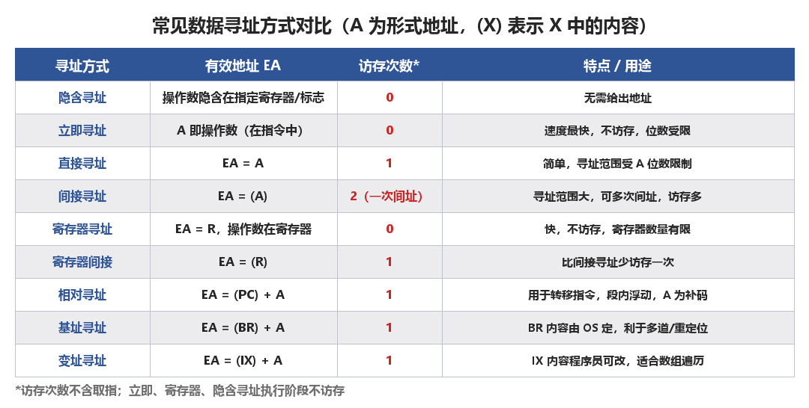

<i>图 4-2 常见数据寻址方式对比</i>

### 5.程序的机器级表示

①相关寄存器名称

$E$前缀→32bit、$A(ACC)$→累加器、$B(Base)$→基址寄存器

$C(Count)$→计数寄存器、$D(Data)$→数据寄存器、$I(Index)$后缀→变址寄存器

$P$后缀→指针：$SP\text{（Stack Point）}$→栈顶指针、$BP\text{（Base Point）}$→栈基指针

$l$→当前寄存器的低位、$h$→当前寄存器的高位

②常用指令

数据传送指令、算术和逻辑运算指令、控制流指令

$\langle reg\rangle$：表示寄存器，后面为寄存器位数

$\langle mem\rangle$：表示内存地址

$\langle con\rangle$：表示常数、后面为常数的位数

$x86$体系（使用$Intel$格式）：即目的地址在高位

【栈中元素固定为$32bit$】

$sub$→减法、$inc$→自增1、$dec$→自减1、$and/or/xor$→按位与/或/异或

$not$→按位取反、$neg$→**【二进制的补码取负数】**、$shl/shr$→**【逻辑】**左移/右移

$imul$→有符号乘法

$mul$→无符号乘法【仅支持但操作数格式，被乘数隐含在$eax$】，结果存放在$edx:eax$中，若$edx\ne 0$则发生溢出

$idiv$→有符号整数除法指令，【仅指定除数，被除数为$edx:eax$组成的$64$位数】

无符号整数除法指令也是$idiv$**【仅对结果解释的时候不同】**

$jmp$→无条件转移指令

$jcondition$→条件转移指令、根据状态标志决定是否转移

$e\to equal$、$z\to zero$、$ne\to not equal$

有符号数：$g\to greater$、$l\to less$

无符号数：$a\to above$、$b\to below$

表 5-1 x86 条件转移指令与标志位对照

| **比较关系** | **数学写法** | **真题选项式写法** | **x86** |
| --- | --- | --- | --- |
| 相等（通用） | ZF = 1 | ZF=1 | JE |
| 不等（通用） | ZF = 0 | ZF=0 | JNE |
| 无符号小于 | CF = 1 | CF=1 | JB |
| 无符号大于等于 | CF = 0 | CF=0 | JAE |
| 无符号小于等于 | CF = 1 ∨ ZF = 1 | CF=1 或 ZF=1 | JBE |
| 无符号大于 | CF = 0 ∧ ZF = 0 | CF=0 且 ZF=0 | JA |
| 带符号小于 | SF ⊕ OF = 1 | SF≠OF | JL |
| 带符号大于等于 | SF ⊕ OF = 0 | SF=OF | JGE |
| 带符号小于等于 | ZF = 1 ∨ (SF ⊕ OF = 1) | ZF=1 或 SF≠OF | JLE |
| 带符号大于 | ZF = 0 ∧ (SF ⊕ OF = 0) | ZF=0 且 SF=OF | JG |

注：∧「且」表示两个条件须同时成立，∨「或」表示至少一个成立，⊕ 表示异或；该表用于理解 if-else 的底层实现，助记符无需死记。

> **📝 【补充】 MIPS（RISC）的条件转移**  
> MIPS 的条件分支指令只有 beq（相等转移）与 bne（不相等转移）两条；  
> 其余大小比较不直接分支，先用 slt rd, rs, rt（set on less than，当 rs<rt，即 a<b 时 rd=1，否则 rd=0）把比较结果存为寄存器中的 0/1，再用 beq/bne 判断该结果完成转移；slti 为立即数版本，sltu、sltiu 为无符号版本。  

$cmp\to $**【相减后不保存结果，仅根据结果设置标志位】**，即$sub$

$test\to $**【按位与运算】**后，根据结果设置标志位，即$and$

$call/ret$→实现程序调用和返回

> **⭐ 【大题考点】**  
> 过程调用的栈帧结构、call/ret 的栈操作、调用者保存与被调用者保存寄存器，可结合出大题  

> **⚠️ 【易错辨析】**  
> 指令助记符后缀表示操作数长度：b、w、l、q 分别对应 1、2、4、8 字节  
> 调用者保存（caller-saved）有 rax、rcx、rdx、rsi、rdi、r8~r11；被调用者保存（callee-saved）有 rbx、rbp、r12~r15；rsp 为栈指针、rbp 为栈帧基址  

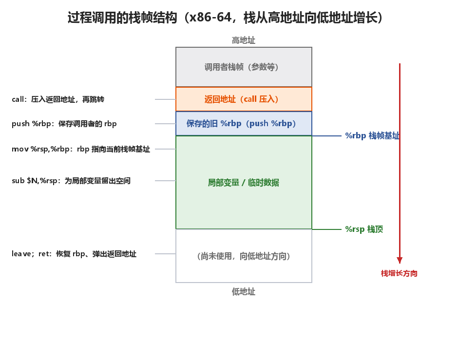

<i>图 4-3 过程调用的栈帧结构</i>

### 6.汇编指令格式

【在$x86$体系中，$word$字始终表示$16$位】

$AT\&T$格式、$Intel$格式

$AT\&T$格式：**【源+目的】**，寄存器前$\%$、立即数前$\$$、使用圆括号

复杂寻址方式表示：$disp(base,index,scale)$→偏移量、基址寄存器、变址寄存器和**【比例因子】**，$EA=R\left[ base \right]+R\left[ index \right]*scale+disp$

操作数长度指定方式：在指令**【助记符后】**加后缀，$b\to byte\text{、}w\to word\text{、}l\to long$

$Intel$格式**【408常用】**：**【目的+源】**、使用方括号

复杂寻址方式表示：$\left[ base+index*scale+disp \right]$→$EA=R\left[ base \right]+R\left[ index \right]*scale+disp$

操作数长度指定方式：在**【内存操作数前】**加前缀，$byte ptr\text{、}word ptr\text{、}dword ptr$

> **⚠️ 【易错辨析】**  
> AT&T 格式源在前、目的在后，寄存器加 %、立即数加 \$、内存用圆括号；Intel（408 常用）目的在前、源在后，内存用方括号  
> 复杂寻址为 偏移量(基址寄存器,变址寄存器,比例因子)，对应 基址 + 变址×比例因子 + 偏移量  

### 7.语句的机器级表示

选择语句：通过**【条件码（标志位）设置指令和各类条件转移指令】**实现条件分支

循环语句：通过**【条件测试和条件转移指令的组合实现循环逻辑】**实现循环

过程调用：通过$\frac{call}{ret}$指令实现，可使用标志

规定：**【调用者】**保存寄存器→$EAX\text{、}ECX\text{、}EDX$；**【被调用者】**保存寄存器→$EBX\text{、}ESI\text{、}EDI$

每个过程在运行时战中分配一块专属区域**【栈帧】**，栈从**【高地址向低地址增长】**

可分为三个阶段

①准备阶段：将当前$EBP$压入栈帧中（保存旧值），随后使$EBP$指向当前栈帧基址（跳转）

②过程体：执行内部代码

③结束阶段：恢复$EBP$旧值（$pop ebp$）使栈帧指针指针恢复之前状态，执行$ret$指令（从栈顶弹出返回地址并转移回调用点）

> **⚠️ 【易错辨析】**  
> 选择语句由条件码（标志位）设置指令加条件转移指令实现；循环语句由条件测试与条件转移组合实现  

> **📝 【补充】**  
> 过程调用时栈从高地址向低地址增长；call 压入返回地址，ret 弹出返回地址；栈帧分准备（保存旧 rbp、设定新 rbp）、过程体、结束（恢复 rbp、ret）三阶段  

### 8.CISC和RISC

$CISC$复杂指令系统计算机**【可以和旧版本兼容】**

$x86$架构

①指令超过200条

②指令长度不固定

③多数指令可直接访存

④各类指令使用频率差异显著

⑤指令执行时间相差大

⑥控制器多采用**【微程序控制】**

⑦难以通过编译优化

$RISC$精简指令系统计算机**【不可和旧版本兼容】**

$ARM\text{、}MIPS$架构

①复杂功能由简单指令组合而成

②指令长度固定

③仅$LOAD/STORE$（取数/存数）指令可以访存，其余运算在寄存器之间运行

④**【需要大量寄存器】**

⑤**【必须实现指令流水线技术】**，大多数指令在一个时钟周期内完成

⑥**【硬布线为主】**

⑦高度依赖编译器优化

$LOAD/STORE$型指令的特点

①访存与计算分离

②指令格式规整：寄存器编号位数少于内存地址

利于流水线执行：统一的指令长度和访存边界可以，简化取指、译码、执行等过程

③频繁的数据迁移可能导致程序的$LOAD/STORE$型指令比例偏高，需要通过编译器或高速缓存机制优化

> **📌 【考点考频】**  
> CISC 与 RISC 的特点对比是选择题高频考点，涉及次数多  

> **⚠️ 【易错辨析】**  
> RISC 指令长度固定、只有 load/store 访存、寄存器多、硬布线控制为主、必须支持流水线、高度依赖编译器优化；CISC 指令长度不固定、多数指令可直接访存、控制器多用微程序、可与旧版本兼容  

> **📝 【补充】**  
> CISC 指令数量多、使用频率与执行时间差异大、编译优化困难；RISC 复杂功能由简单指令组合、多数指令单周期完成  

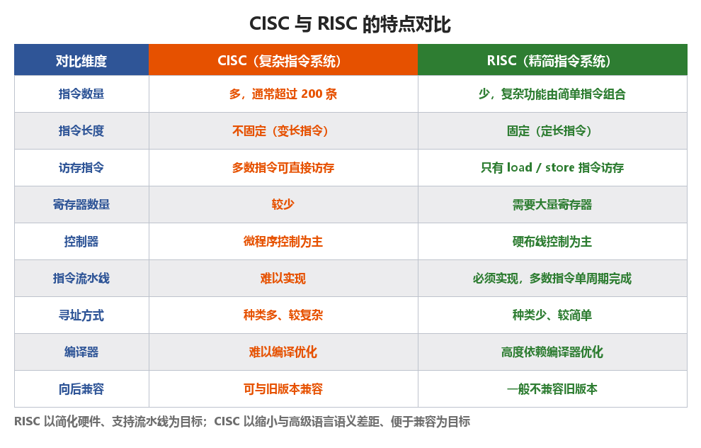

<i>图 4-4 CISC 与 RISC 的特点对比</i>

# 第五章 中央处理器

### 1.CPU的基本结构

指令控制→程序计数器$PC$

指令译码→指令寄存器$IR$（暂存当前指令）、指令译码器$ID$

生成微操作控制信号序列→控制单元$CU$

数据通路→算术逻辑单元$ALU$、通用寄存器组$GPRs$

响应异常和外部中断→中断机构

$CPU$与主存的数据交换→存储器地址寄存器$MAR$、存储器数据寄存器$MDR$

提供时序基准→时序信号产生部件

对总线传输的控制→总线控制逻辑

> **📌 【考点考频】**  
> 本章是 CPU 大题的主战场，数据通路、控制器、流水线、中断都可能出综合题，选择题也很密集  

> **⚠️ 【易错辨析】**  
> CPU 的功能包括指令控制、操作控制、时间控制、数据加工，外加异常和中断处理；数据加工是根本任务  
> PC 负责指令控制，IR 暂存当前指令、ID 负责译码，CU 生成微操作控制信号，ALU 与通用寄存器组构成数据通路  

> **📝 【补充】**  
> MAR、MDR 负责 CPU 与主存的数据交换，时序信号产生部件提供基准，中断机构负责异常与外部中断  

### 2.CPU中的寄存器

用户可见寄存器：$GPRS\text{、}$专用地址寄存器、$PC$

只读型寄存器→标志寄存器$FR$

用户不可见寄存器**【对用户完全透明，不可读取、修改】**：指令寄存器$IR\text{、}MAR\text{、}MDR\text{、}$页表基址寄存器

> **⚠️ 【易错辨析】**  
> 用户可见寄存器有通用寄存器组 GPRs、程序计数器 PC、程序状态字 PSW；用户不可见（完全透明）有 IR、MAR、MDR  
> PC 可由程序员通过转移指令改变，属可见；IR 只在 CPU 内部暂存指令，对程序员透明，二者不要混  

> **📝 【补充】**  
> PSW 存放 OF、SF、ZF、CF、IF 等状态与控制标志；通用寄存器可兼作寻址、暂存操作数与结果  

### 3.CPU的时序控制

时钟周期的长度由数据通路中相邻状态单元之间组合逻辑的最大传播延迟决定

早期计算机采用三级时序系统：机器周期→节拍→脉冲

一个指令周期被划分为若干机器周期

现代计算机一个时钟周期对应一个节拍

> **⚠️ 【易错辨析】**  
> 时钟周期（节拍）是 CPU 最小的时间单位，机器周期（CPU 周期）含若干时钟周期，指令周期含若干机器周期  
> 时钟周期长度由数据通路中相邻状态单元间组合逻辑的最大传播延迟（关键路径）决定，不能随意缩短  

> **📝 【补充】**  
> 早期机器用三级时序：机器周期→节拍→脉冲；现代计算机一个时钟周期对应一个节拍  

### 4.指令周期的基本概念

完整的指令周期组成

指令周期=取指+（间址）+执行+中断

分为定长指令周期、变长指令周期

> **⚠️ 【易错辨析】**  
> 指令周期 = 取指 +（间址）+ 执行 + 中断，间址周期与中断周期并非每条指令都有，取指周期是公共操作  
> 取指、间址、中断阶段对各类指令通用，只有执行阶段的微操作随指令类型变化  

> **📝 【补充】**  
> 指令周期按长度是否固定分为定长指令周期与变长指令周期  

### 4.处理器指令执行模型

①单周期处理器

每条指令在一个时钟周期内完成$CPI$（$CPI=1$）

②多周期处理器

不同指令客栈用不同数量的时钟周期，根据指令动态分配执行周期数$CPI$通常大于1

③流水线处理器

采用**【指令级并行策略】**，理想情况$CPI=1$

> **⚠️ 【易错辨析】**  
> 单周期处理器每条指令一个时钟周期、CPI=1，但周期长度必须取最慢指令，简单指令也被拖慢、效率低  
> 多周期处理器按指令动态分配周期数、共享部件、周期短；流水线处理器靠指令级并行，理想情况每周期完成一条  

> **📝 【补充】**  
> 单总线结构一个周期只能进行一次数据传输，无法实现单周期数据通路  

### 5.数据通路的功能和基本结构

由组合逻辑元件和时序逻辑元件两大类元件组成

组合逻辑元件（操作元件）：任意时刻的输入仅由当前输入决定

时序逻辑元件（状态元件）：输出不仅取决于当前输入，还依赖于电路历史状态，**【内部包含存储信息的记忆原件】**

寄存器延迟：${T}_{cl{k}_{t{o}_{q}}}$→寄存器A输出稳定的时延

关键路径延迟：${T}_{max}$→**【所有数据到达稳定的时延】**

寄存器建立时间：${T}_{setup}$→寄存器的输入在时钟沿到来前保持稳定所需时间

> **⚠️ 【易错辨析】**  
> 组合逻辑元件（操作元件）输出只由当前输入决定、无记忆，如 ALU、多路选择器、加法器  
> 时序逻辑元件（状态元件）含记忆、依赖历史状态，在时钟沿触发，如各类寄存器、存储器  
> 关键路径延迟决定时钟周期下限；建立时间是数据在时钟沿前须保持稳定的时间，还有保持时间  

> **📝 【补充】**  
> 寄存器延迟、关键路径延迟、建立时间是分析能否在一个周期内完成的三个量  

### 6.数据通路的组织与分类

按部件连接方式划分

①总线式数据通路

单总线结构：所有数据传输共享一条内部总线

**【一个时钟周期仅有一个数据传输】**

**【不能实现单周期数据通路】**

【数据通路中不设置$IR$指令寄存器】

【注意】在数据通路中，一般所有输出到总线上的路径都有一个**三态门**（三态缓冲器，输出为 0、1、高阻三种状态）；若没有三态门，该硬件会持续向总线输出数据，多个部件同时驱动总线时会发生**总线竞争（总线冲突）**。

同一时刻只允许一个部件打开三态门向总线输出；寄存器从总线打入数据（输入）由打入使能（$CLK$/Load）控制，不需要三态门——即**输出到总线用三态门，从总线打入用控制门**。

多总线结构

②专用数据通路

用点对点专用连线连接寄存器、$ALU$等部件。可并行传输

按时序组织方式划分

①单周期数据通路

每条指令都在一个时钟周期内完成→取决于最慢的指令（通常是访存指令）

**【单周期处理器不能实现单周期数据通路→因为单周期处理器一个时钟周期只能进行一次操作，无法完成整条指令】**

②多周期数据通路

将一条指令的执行划分为多个阶段，每个阶段在一个时钟周期内完成

各阶段的结果在时钟边沿被所存到了寄存器中，**【时钟周期长度通常以一次存储器访问时间为基准】**

③流水线数据通路

将指令执行过程分解成若干独立可重叠的阶段，不同该指令在不同阶段并发推进

**【通过流水段寄存器隔离和传递中间结果】**

**【时钟周期由最长阶段决定，理想状态下每个周期可以完成一条指令】**

> **⭐ 【大题考点】**  
> 单周期、多周期、流水线数据通路的结构与时钟周期取值，可结合具体指令出大题  

> **⚠️ 【易错辨析】**  
> 单总线一个周期只有一次数据传输、不能实现单周期、数据通路中不设 IR；专用数据通路点对点连接、可并行传输  
> 单周期数据通路的周期由最慢指令（通常是访存指令）决定，其余指令效率受限  

> **📝 【补充】**  
> 多周期把指令分阶段、各阶段结果在时钟沿锁存，时钟周期通常以一次访存时间为基准  

### 7.指令执行过程书写

取指阶段、间址阶段、中断阶段的指令执行过程通用、**【仅指令执行阶段的过程不同】**

> **⭐ 【大题考点】**  
> 写出某指令在取指、间址、执行、中断各阶段的微操作序列（带控制信号）是常考大题，三段通用、仅执行不同  

> **⚠️ 【易错辨析】**  
> 取指通用步骤：PC→MAR，发读命令，M(MAR)→MDR，MDR→IR，(PC)+1→PC  

> **📝 【补充】**  
> 书写微操作时要标明数据通路操作和所用时钟周期，顺序不能颠倒  

### 8.专用结构的数据通路

取指令部件的设计

$R$型运算类指令数据通路：**【操作数全来自通用寄存器、运算结果写回通用寄存器的算数/逻辑运算指令】**

$I$型运算指令的数据通路：**【立即数运算类指令→先拓展为32位】**，再进行计算

支持$R/I$型运算指令的数据通路的特点

①目的寄存器选择：$R$性质零使用目的寄存器$Rd$，$I$型指令使用目的寄存器$Rt$，【在寄存器堆的写地址段$Rw$增设多路选择器】，控制信号$RegDst$控制→为1执行$R$型指令

②立即数扩展：新增一个立即数扩展器，输入为指令的$imm16$字段，【有控制信号$ExtOp$决定扩展方式】

③$ALU$第二操作数选择：$R$型的第二操作数来自$Rt$、而$I$型使用扩展后的立即数，在$ALU$第二输入端增设多路选择器，有控制信号$ALUSrc$控制→为0执行$R$型

访存指令的数据通路：$MIPS$访存指令属于$I$型指令

①写回寄存器的数据选择：在寄存器堆的写端口$busW$除增设一个多路选择器，有控制信号$MemtoReg$控制→为0表示运算类指令，选择$ALU$运算结果；为1表示$LOAD$指令，选择数据存储器读出数据

②新增数据存储器模块：满足$LOAD/STORE$指令堆数据存储器的读/写要求

完整单周期处理数据通路

①存储器分离设计：指令存储器与数据存储器相互独立

②无指令寄存器$IR$：**【指令的解析与执行在同一个时钟周期内同步完成】**

③时钟周期由最慢指令决定：时钟周期必须满足执行时间最长的指令（访存指令），导致$R$型指令的执行效率受限

④数据通路资源专用

⑤控制信号单周期有效：所有控制信号在一个时钟周期内保持有效，指令的完整流程在单个时钟脉冲内完成，无流水线分段

> **⭐ 【大题考点】**  
> R 型、I 型、load/store 数据通路中多路选择器、立即数扩展器、写回选择的位置与控制信号是大题重点  

> **⚠️ 【易错辨析】**  
> 单周期采用指令存储器与数据存储器分离设计，不设 IR，指令解析与执行在同一周期完成  
> 单周期所有控制信号在一个周期内有效、数据通路资源专用，无流水段寄存器  

> **📝 【补充】**  
> load 型指令在寄存器堆写端口增设多路选择器，在 ALU 结果与数据存储器读出数据之间选择  

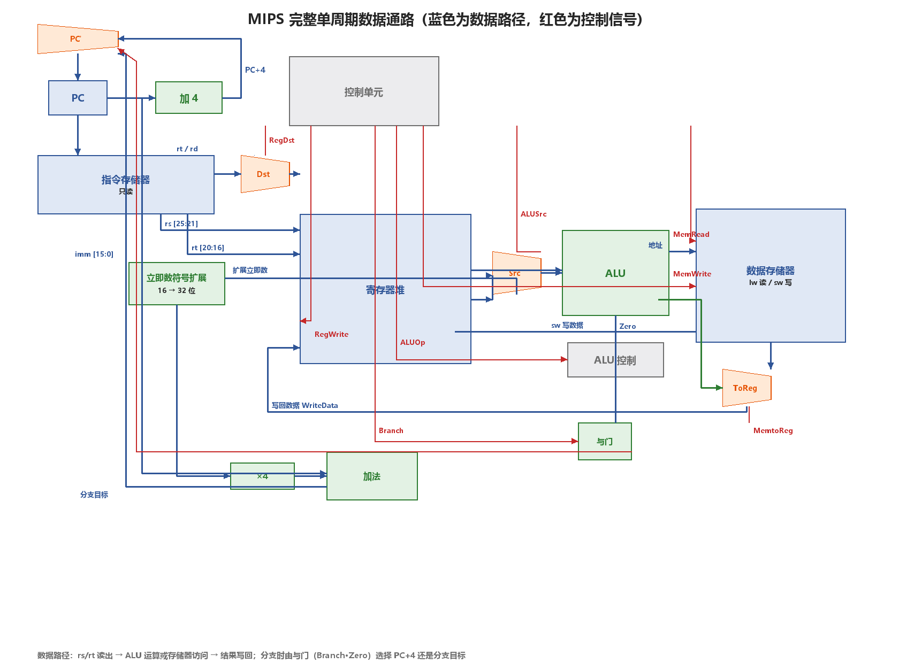

<i>图 5-1 MIPS 完整单周期数据通路</i>

### 9.控制器的结构和功能

控制器是计算机的指挥中心，主要职责

①取出指令并更新$PC$

②对指令的**【操作码进行解码】**，产生对应的时序信号和控制信号

③管理数据流向及时序 

根据微操作控制信号的生成方式不同，可分为硬布线控制器和微程序控制器

> **⚠️ 【易错辨析】**  
> 按微操作控制信号的生成方式，控制器分为硬布线控制器（组合逻辑）与微程序控制器（存储逻辑）  
> 控制器职责：取指并更新 PC、对操作码译码产生时序和控制信号、管理数据流向与时序  

### 10.硬布线控制器

组合逻辑控制器，根据指令需求、当前时许和内部状态，按时间顺序生成一系列微操作控制信号，用于$RISC$

指令寄存器$IR$会对$n$为操作码进行译码

$CU$控制单元的输入主要包括三类信号

①操作译码器输出的**【指令信息】**，与节拍信号共同用于生成相应的微操作控制信号

②**【时钟脉冲】**，其频率为机器主频，用于划分节拍

③执行单元反馈的**【状态标记】**

> **⚠️ 【易错辨析】**  
> 硬布线控制器是组合逻辑电路，输入为指令操作码译码、时钟/节拍信号、执行单元反馈的状态标志  
> 硬布线速度快，但电路不规整、扩充和修改指令困难，RISC 多采用  

> **📝 【补充】**  
> 指令寄存器先对操作码译码，再与节拍、状态共同生成微操作控制信号  

### 11.微程序控制器

采用**【存储逻辑】**实现，用于【$CISC$】

核心思想

将控制器所需的微操作控制信号组织为**【微指令】**，并执行每条机器指令所需的**【微指令序列（微程序）】**预先存入一个专用的高速存储器【控制存储器$CM$】中，运行时根据读取的微指令生成相应的微操作信号

一条机器指令→微指令序列/微程序、一个微程序→多条微指令

一条微指令→多条微命令，微命令→微操作一一对应

微命令分为相容性微命令（坑同时有效、协同完成某一功能）、互斥性微命令（同一时刻不能同时有效）

> **⚠️ 【易错辨析】**  
> 微程序控制器采用存储逻辑，把微操作编成微指令、把微程序预先存入控制存储器 CM  
> 一条机器指令对应一段微程序（多条微指令），一条微指令含多个微命令，微命令与微操作一一对应  
> 相容性微命令可同时有效、协同完成功能，互斥性微命令同一时刻不能同时有效  

> **📝 【补充】**  
> 控制存储器位于 CPU 内部，用 ROM 实现，存放全部机器指令对应的微程序  

### 12.微程序的设计

微指令：由若干微命令的集合，包括两个字段

①操作控制字段（微操作码字段）：胜场当前步骤所需的微操作控制信号

②顺序控制字段（下址字段）：用于确定吓一跳为指令的地址

微周期：执行一条微指令所需要的基本时间单位（通常为一个时钟周期）

主存储器与控制存储器：控制存储器存放微程序，位于$CPU$内部，通常使用$ROM$实现

控制存储器中的每个存储单元的地址为微地址

程序与微程序：微程序本质上时机器指令的**【硬件及解释逻辑】**

微地址寄存器$\mu PC/CMAR$：存放待执行微指令在控制存储器中的微地址

微指令寄存器$\mu IR/CMDR$：存放从控制存储器读出的当前微指令

微程序综述=机器指令跳数+公共微程序数（如取指、间址、中断等）

> **⚠️ 【易错辨析】**  
> 微指令含两个字段：操作控制字段（微操作码，给出微操作控制信号）与顺序控制字段（下址，确定下条微指令地址）  
> 微周期是执行一条微指令的基本时间，通常为一个时钟周期  

> **📝 【补充】**  
> 微地址寄存器存放待执行微指令地址，微指令寄存器存放读出的当前微指令；微程序总数=机器指令数+公共微程序数  

### 13.微程序控制器的组成和工作过程

微程序控制器主要由以下部件组成

①微地址形成部件：根据机器指令的$OP$+当前微指令的顺序控制字段及状态条件，**【产生后续微指令地址】**

②微指令地址寄存器（$\mu PC/CMAR$）：接受微地址形成部件提供的微地址，作为$CM$的读地址

③控制存储器：核心部件，存放所有机器指令对应的微程序

④微指令寄存器$\mu IR/CMDR$：暂存从$CM$中读出来的微指令，并将其操作控制字段和顺序控制字段分别送进执行单元和微地址形成部件

微程序控制器的工作流程

①执行取指令公共操作：系统启动或每条指令执行完毕后，【将取指微程序的入口（通常为$CM$的0号单元）送入$\mu PC$】

②生成当前指令的微程序入口地址：$IR$中$OP$通过微地址形成部件生成地址送入$\mu PC$

③顺序执行微程序：从$CM$逐条读取微指令，送入$\mu IR$并执行，直至该微程序执行完毕

④返回循环：返回步骤①，直至程序执行结束

> **⭐ 【大题考点】**  
> 微程序控制器的组成（微地址形成部件、微地址寄存器、控制存储器、微指令寄存器）与工作流程是大题点  

> **⚠️ 【易错辨析】**  
> 工作流程：执行取指公共微程序→形成当前指令微程序入口地址→顺序执行微程序→返回循环  

> **📝 【补充】**  
> 系统启动或一条指令完成后，取指微程序入口（通常为 CM 的 0 号单元）被送入微地址寄存器  

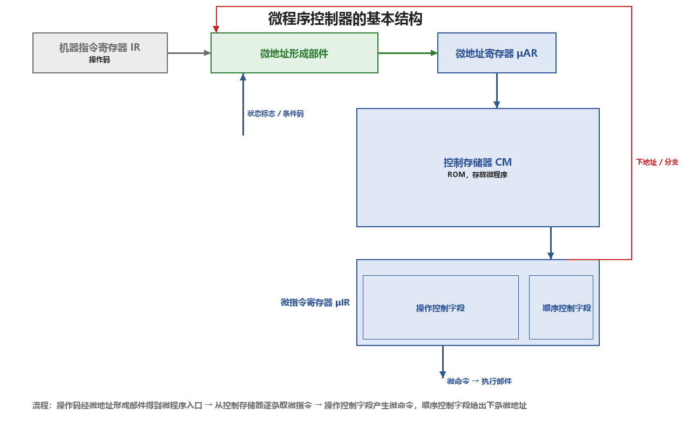

<i>图 5-2 微程序控制器的基本结构</i>

### 14.微指令的编码/控制方式

直接编码/控制方式

每一位直接对应一个微指令，无需译码

字段直接编码方式

将操作控制字段划分为若干**【互斥段，互斥性微指令被归入同一字段、相容性微指令分配到不同字段】**

分段规则：

①互斥性微指令必须在同一字段，相容性微指令在不同字段

②每个字段的位数不宜过多

③**【每个字段通常还需预留一个编码表示“本字段无操作“】**

字段间接编码方式

进一步压缩为指令长度，某个微命令字段的实际含义，由另一个字段的编码共同决定

有**【段选位】**

三种编码方式的实例

两类互斥操作：$ALU$操作（4种）+存储器操作（4种）

直接编码：8位

字段编码：每个互斥段（5种操作=4相容+1字段无效）3位，共两个互斥段→共6位

字段间接编码：段选位（1位，选择操作类别）+3位（5种操作=4相容+1字段无效）→共4位

> **⭐ 【大题考点】**  
> 三种编码方式的位数计算是高频：直接编码、字段直接编码、字段间接编码  

> **⚠️ 【易错辨析】**  
> 直接编码每位对应一个微命令、无需译码、速度最快但字长最长  
> 字段直接编码把互斥微命令归入同一字段、相容微命令分到不同字段，每字段留一个“无操作”编码，需译码  
> 字段间接编码靠段选位加字段共同决定含义，字长最短但速度最慢  

> **📝 【补充】**  
> 例：8 种操作，直接编码 8 位；字段直接编码两个互斥段各 3 位共 6 位；字段间接编码 1 位段选+3 位共 4 位  

### 15.微指令地址的形成方式

增量方式（计数器方式）：从$\mu PC+"1"$

断定方式（下地址字段方式）当前微指令显式指定下地址

下条微地址的**【确定】**方式

①微程序入口地址的形成

②顺序执行：增量方式/断定方式

③条件分支：根据状态标志和外部条件，为地址形成不见与当前微指令下址字段指定的目标地址确定

④由专门硬件产生第一条指令地址

⑤通过测试网络确定

> **⚠️ 【易错辨析】**  
> 增量方式（计数器方式）用微程序计数器 μPC 加 1 得到下址；断定方式由当前微指令的下地址字段显式指定  

> **📝 【补充】**  
> 微程序入口地址由机器指令操作码经微地址形成部件产生，分支时结合状态条件确定  

### 16.微指令的格式

①水平型微指令

每一位/每一字段对应一个微命令。可同时定义并执行多个并行的微操作

基本格式：操作控制+顺序控制（判断测试字段+后续地址字段）

②垂直型微指令

微指令中设置微操作操作码字段，通过译码产生控制信号

基本格式：微操作码$\mu OP$+目的地址$Rd$+源地址$Rs$

水平型的并行能力强、灵活性强

**【单条水平型指令完成更多工作】**、垂直型需要多条微指令完成同等任务

水平型微指令字长长，但微程序短

水平型微指令的微程序编写难度大、垂直型类似于机器指令，易编写

> **⚠️ 【易错辨析】**  
> 水平型微指令一位/一字段对应一个微命令、可同时定义多个并行微操作，字长长、微程序短、灵活但编写难  
> 垂直型微指令设微操作码经译码产生控制，类似机器指令，字长短、微程序长、易编写但并行能力弱  

> **📝 【补充】**  
> 水平型格式为操作控制+顺序控制，垂直型格式为微操作码+目的地址+源地址  

### 17.硬布线控制器和微程序控制器的比较

硬布线执行速度快难扩展、微程序基于**【存储程序原理】**易扩展

> **⚠️ 【易错辨析】**  
> 硬布线执行速度快、电路不规整、难扩展；微程序基于存储程序原理、规整、易扩展但速度慢  

> **📝 【补充】**  
> RISC 多用硬布线，CISC 多用微程序；新增指令时微程序只需改写 CM 内容  

### 18.异常和中断

异常（内中断）：$CPU$在**【指令执行的过程中】**，有内部检测到的同步事件。

中断（外中断）：外部设备引起的异步事件。

异常的分类

硬件故障中断：硬件逻辑功能出现异常→存储器校验错、总线错误等

程序性异常（软件中断）：$CPU$内部因执行指令引起的异常事件

按照发生原因和返回方式可分为

①故障$Fault$：指令启动之后、执行完成之前被检测到的异常事件。重新执行发生错误的指令

②自陷$Trap$：预先安排的，用于主动转入操作系统内核的同步事件。指令正常执行完毕之后才被触发

③终止$Abort$：发生严重的硬件故障，程序被迫终止

中断的分类

①可屏蔽中断：通过可屏蔽中断请求先$INTR$发送

②不可屏蔽中断：通过不可屏蔽中断请求线$NMI$发送，无法被软件屏蔽

根据程序入口地址的获取方式：向量中断、非向量中断

根据是否允许嵌套处理：单重中断、多重中断

> **📌 【考点考频】**  
> 异常与中断的分类、响应过程是选择题高频点，也可结合大题  

> **⚠️ 【易错辨析】**  
> 异常（内中断）是指令执行中由内部检测到的同步事件；中断（外中断）是外部设备引起的异步事件  
> 故障 fault 在指令执行中被检测、可重新执行；自陷 trap 是有意安排、指令正常执行后触发；终止 abort 是严重故障、被迫终止  
> 外中断分为可屏蔽中断（INTR、可被软件屏蔽）与不可屏蔽中断（NMI、无法屏蔽）  

> **📝 【补充】**  
> 按入口地址获取方式分向量中断、非向量中断；按是否允许嵌套分单重中断、多重中断  

### 19.异常和中断响应过程

主要包括：关中断、保存断点和程序状态、识别事件类型并转移至处理程序

①关中断：通过【清零标志寄存器的$IF$位】标识→为0时关中断

②保存断点和程序状态**【硬件自动保存】**：$CPU$保存两类关键上下文信息→断点、程序状态字$PSW$

**【现场信息（通用寄存器）的保护由操作系统实现】**

③识别事件类型并转移至处理程序

硬件向量机制（向量中断）：系统初始化时，将对应服务程序的入口地址（中断向量）按类型好顺序填入中断向量表

软件轮询机制（非向量中断）：$CPU$响应请求后转移至统一入口，操作系统需要一次读取各设备的状态寄存器，通过查询确定中断源【$CPU$一直处于忙状态】

> **⭐ 【大题考点】**  
> 中断响应三步骤（关中断、保存断点和程序状态、识别事件并转移处理程序）及由硬件还是软件完成是大题点  

> **⚠️ 【易错辨析】**  
> 断点与程序状态字由硬件自动保存，通用寄存器等现场信息由操作系统（软件）保护  
> 关中断通过清零标志寄存器的中断允许位 IF 实现  

> **📝 【补充】**  
> 向量中断查中断向量表得到入口地址；非向量中断由软件轮询各设备状态寄存器确定中断源  

### 20.指令流水线的基本实现

**【高效性依赖于连续、无中断的指令流】**

提升处理器并行性的两种方式：时间上并行→指令流水线技术；空间上并行→在一个处理器内配置多个相同的功能部件，即超标量处理器

经典的五段流水线将指令执行划分为

取指$IF$→译码/读寄存器$ID$→执行/计算地址$EX$→访存$MEM$→写回$WB$

通过重叠执行，在理想情况下（无冒险、无停顿），每条指令平均时钟周期数$CPI\approx 1$

流水线对指令集的要求

①定长、②格式规整、③采用$LOAD/STORE$架构、④数据与指令**【按边界对齐存放】**

流水线设计原则

①流水段的数量以最复杂指令所需的功能段数为准

②每个流水段的时长以最耗时的操作为准

流水线的逻辑结构

**【每个流水段之后都需要设置一个流水段寄存器】**，用于所存该段的输出结果

所有寄存器和数据存储器均采用统一时钟$CLK$同步：没来一个时钟脉冲，将处理完成的数据锁存至段尾寄存器

最多可同时由五条指令处于不同的执行阶段

流水线的时空图

横轴表示时间，纵轴表示流水段

流水线的吞吐率$TP=\frac{n}{{T}_{k}}$，$n$为任务总数，${T}_{k}$为完成这$n$个任务的总时间

设流水线共有$k$段，时钟周期为$∆t$，理想状态下完成$n$个任务的时间为$(k+n-1)∆t$

当$n\to \infty $时，吞吐率达到的理论最大值$\frac{1}{∆t}$

> **📌 【考点考频】**  
> 流水线是本章最高频考点，时空图、吞吐率/加速比/效率、冒险处理几乎必考大题  

> **⭐ 【大题考点】**  
> 五段流水线：IF 取指→ID 译码/读寄存器→EXE 执行/计算地址→MEM 访存→WB 写回  
> 吞吐率 TP=任务数/总时间，加速比 S=串行时间/流水时间，效率 E=时空图有效区/总面积  

> **⚠️ 【易错辨析】**  
> 每个流水段之后都要设流水段寄存器（IF/ID、ID/EXE、EXE/MEM、MEM/WB），用于隔离和传递中间结果  
> 流水线要求指令定长、格式规整、采用 load/store 架构、数据与指令按边界对齐存放  

> **📝 【补充】**  
> 时间上并行靠流水线，空间上并行靠在处理器内配置多个相同功能部件（超标量）  

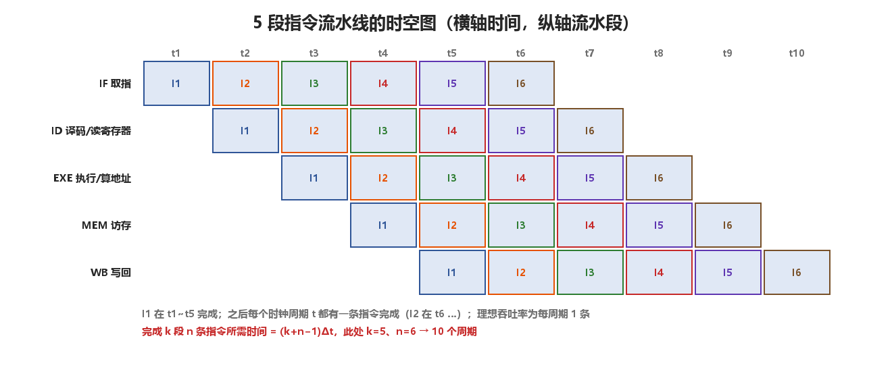

<i>图 5-3 5 段指令流水线的时空图</i>

### 21.MIPS指令级的流水段分析

$R$型指令→4段、$I$型→4段、$lw$指令→5段、$sw$指令→4段、$beq$指令→将写操作安排到$Mem$段，4段、$j$指令→3段

$lw$指令最复杂，需要5个功能段，因此其他指令需要插入空段，对齐至5段

插入空段的规则：每条指令对任意功能部件至多使用一次、相同功能部件必须在固定阶段使用

$R\text{、}I$型→$Write$前插入空$Mem$段、$sw\text{、}beq$→在$Exec$后插入空$Write$段

$j$指令→插入空$Mem\text{、}Write$段

> **⭐ 【大题考点】**  
> 不同类型指令在各流水段的操作、空段插入位置，是流水线大题的常见问法  

> **⚠️ 【易错辨析】**  
> load 指令最复杂、需 5 个功能段，其他指令要插入空段对齐到 5 段  
> 空段规则：每条指令对任一功能部件至多使用一次，相同功能部件必须在固定阶段使用  

> **📝 【补充】**  
> R 型、I 型、store 多为 4 段，分支指令约 3～4 段，load 为 5 段  

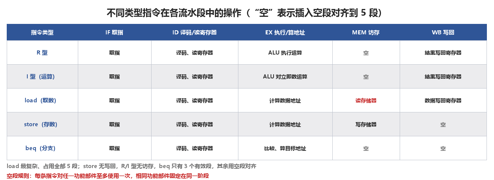

<i>图 5-4 不同类型指令在各流水段中的操作</i>

### 22.流水线的冒险与处理

指令流水线中，某些情况可能导致后续指令无法正确执行，引起流水线阻塞→流水线冒险

流水线冒险分为：结构冒险、数据冒险、控制冒险

①结构冒险（资源冲突）：不同指令在同一时刻争夺同一功能部件

解决方法：遵循功能部件使用原则、增加硬件资源

②数据冒险（数据相关）：后面指令会用到前面指令的结果**【即指令具有同步关系】**，而前面指令的结果还未产生或写回

【按序发生、按序完成（非乱序）的流水线中，所有数据冒险都是$RAW$写后读冲突】

**【数据冒险判断技巧】**：判断当前指令正在写入的寄存器，检查其**【后三条指令】**是否对该寄存器进行了读操作；若存在读操作，则存在数据冒险，否则不存在数据冒险。

解决$RAW$冲突的方式

①延迟执行相关指令

将数据相关的指令及其后续指令都暂停若干时钟周期，直到前一条指令可被安全读取

两种方式实现：软件插入空操作$nop$、硬件自动插入气泡（阻塞）

注意区分寄存器是否支持**【在一个时钟周期的前半个时钟周期写入、后半个时钟周期读出】**→若支持则两条指令可在同一时段读取、写入

②采用转发（旁路）技术

设置相关的转发旁路，将执行阶段生成的中间结果直接【转发至$ALU$的输入端】

解决：相邻的两条运算指令的$RAW$ 、两条运算指令中间隔一条无关指令的$RAW$

③$load-use$数据冒险处理

$load$指令与其后紧邻的运算类指令存在数据相关，无法使用转发技术解决

转发技术可以解决大部分数据冲突，但**不可以解决**$load-use$**引发的数据冲突**，因为$load$的取数不在$ID$阶段，而是在$MEM$阶段，**故需要阻塞一个时钟周期**

解决：由**【编译器】**，在运算类指令前插入一条$nop$指令

③控制冒险（控制冲突）

指令通常按顺序执行，但由于某些事件$PC$值会改变，导致流水线中断

控制类冒险→$PC$值的修改**一定发生在**$MEM$**阶段**

延迟损失时间片$C$→因流水线阻塞产生的延迟时钟周期数

解决控制冒险的方法

&nbsp;&nbsp;①延迟分支处理：如分支指令引起的，可由软件在分支指令之后插入若干$nop$指令或由硬件自动阻塞。【插入$nop$的数量=分支延迟周期数】

&nbsp;&nbsp;②分支预测技术：**【尽早生成转移目标地址】**并预测转移方向

&nbsp;&nbsp;静态预测：简单规则→预测转移发生或不发生

&nbsp;&nbsp;动态预测：根据程序运行时的转移历史动态调整预测策略→若预测错误则需清空已预测的错误路径指令，并从正确目标地址重新取指

> **⭐ 【大题考点】**  
> 三类冒险的判断、解决方法及阻塞（气泡）周期数计算必考  

> **⚠️ 【易错辨析】**  
> 结构冒险是资源冲突，靠功能部件分离或重复设置、指令/数据 Cache 分离解决  
> 数据冒险是数据相关，按序流水线中都是写后读 RAW，靠暂停/插气泡、转发旁路、编译器插 nop 解决  
> 转发能解决相邻 ALU 指令相关；load 后紧邻使用该数据存在 load-use 冒险，必须停顿 1 个周期，不能纯转发  
> 控制冒险由转移改变 PC 引起，靠分支预测、延迟分支、提前生成目标地址解决  

> **📝 【补充】**  
> 若寄存器支持前半周期写、后半周期读，则 WB 段写回与 ID 段读取可在同一周期完成，消除该类相关  

### 23.高级流水线技术

两种主要策略可用于提升指令级并行度

多发射技术：配置多个内部功能部件，使流水线在每个时钟周期能同时处理多条指令，**【一个处理器一次可发射多条指令进入流水线执行】**

超流水线技术：通过增加流水线的级数，使更多指令在流水线中重叠执行

①超标量流水线技术（动态多发射）

每个时钟周期可并发发射多条独立指令，简单超标量流水线的指令按顺序发射

线代的超标量处理器结合动态调度技术，支持乱序执行

②超长指令字技术（静态多发射）

由**【编译器发掘指令间的并行性】**，并将多条可并行执行的指令打包成**【超长指令字】**（水平型指令）

超长指令字包含多个操作码字段，分别控制不同处理部件

③超流水线技术

进一步细分流水段来缩短时钟周期，提高主频和指令吞吐率。会增加流水段寄存器开销、更高的复杂度

【超流水线$CPU$在流水线满后，$CPI=1$，但主频更高】

多发射$CPU$每个时钟周期可完成多条指令$CPU\lt 1$

> **⚠️ 【易错辨析】**  
> 多发射技术使每周期处理多条指令，分超标量（动态多发射、硬件调度、可乱序）与超长指令字 VLIW（静态多发射、编译器打包）  
> 超流水线技术通过细分流水段缩短周期、提高主频，会增加段寄存器开销  

> **📝 【补充】**  
> 超标量靠硬件发掘并行，VLIW 靠编译器发掘并行；超流水线是“更深”，多发射是“更宽”  

### 24.多处理器的基本概念

①$SISD$单指令流单数据流：常规单处理器，一个处理器+一个存储器，传统的串行计算机结构

部分$SISD$计算机采用：指令流水线+设置多个功能部件+多模块交叉组织存储器

②$SIMD$单指令流多数据流：采用**【数据级并行技术】**，由**【一个指令控制单元+多个处理单元】**组成、所有处理单元同时执行同一条指令，单各自拥有独立的地址寄存器，可以操作不同的数据

便于处理循环类语句、不便于处理分支语句，难以保持同步

向量处理器→$SIMD$，通过专用指令直接操作一维数组：将数据从存储器加载到向量寄存器，以流水线方式批量处理

③$MISD$多指令流单数据流：理论存在但无实际应用

④$MIMD$多指令流多数据流：常规多处理器，同时执行多条指令分别处理多个不同的数据流，分为多计算机系统、多处理器系统两类，支持**【线程级、任务级并行】**

多计算机系统（消息传递型$MIMD$）→每个节点拥有私有存储器和独立的地址空间，无法通过普通访存指令直接访问其他节点的内存，**【需要依赖消息传递进行通信】**

多处理器系统（共享型$MIMD$）：同产值共享存储多处理器系统，具有统一的全局地址空间

> **⚠️ 【易错辨析】**  
> Flynn 分类：SISD 单处理器、SIMD 数据级并行、MISD 无实际应用、MIMD 多处理器/多计算机  
> SIMD 由一个控制单元加多个处理单元构成，适合循环、不适合分支；向量处理器是其代表  
> MIMD 分多计算机（消息传递、私有内存）与多处理器（共享内存、统一地址空间）  

> **📝 【补充】**  
> SISD 也可采用指令流水线、多个功能部件、多模块交叉存储器来提升性能  

### 25.硬件多线程

为了降低线程切换的开销，处理器为每个线程配备独立的通用寄存器组、程序计数器等关键状态部件，线程切换时只需要激活对应现成的寄存器组，无需将上下文写入或从内存读出，从而大幅降低切换延迟

主要有三种实现方式

①细粒度多线程

处理器在每个时钟周期切换线程，交替执行不同现成的的指令

②粗粒度多线程

处理器连续执行同一线程的**【指令序列】**，仅当线程因高延迟时间导致流水线阻塞才切换线程

③同时多线程$SMT$

**【真正的指令级并行，实现了线程级并行】**

在单格式中周期内可同时发射并执行来自多个不同线程的**【多条指令】**，通常构建于**【超标量+乱序执行（分支预测技术）的微架构之上】**

$Intel$超线程技术：属于$SMT$，在一个物理和心中维护两套完整的线程状态部件，而高速缓存、$ALU$等执行资源有两个逻辑核心共享

> **⚠️ 【易错辨析】**  
> 细粒度多线程每个时钟周期切换线程、交替执行；粗粒度多线程连续执行同一线程、遇长延迟才切换  
> 同时多线程 SMT 单周期内可发射多个线程的多条指令，实现指令级与线程级并行，基于超标量乱序架构  

> **📝 【补充】**  
> 超线程（Hyper-Threading）属于 SMT，一个物理核维护两套线程状态，Cache 与执行资源由两个逻辑核共享  

### 26.多核处理器

即片上多处理器→将多个独立的处理单元集成到单个$CPU$上，每个处理单元称为一个核

每个核通常有独立$Cache$→而独立$Cache$共享更高层级的$Cach$→**【所有和通过互连网络共享主存储器】**

支持多线程在物理上同时执行，单核系统→多线程以时间交错方式执行或通过同时多线程$SMT$在单个核上并发执行不同线程的多条指令

> **⚠️ 【易错辨析】**  
> 多核即片上多处理器 CMP，各核通常有独立的低层 Cache、共享更高层 Cache，并通过互连网络共享主存  

> **📝 【补充】**  
> 多核可让多个线程真正并行；单核上的多线程是时间交错或靠 SMT 并发  

### 27.共享内存多处理器SMP

所有$CPU$可通过常规的访存指令访问任意位置的内存，并通过读/写共享变量进行通信

【物理地址同一，但逻辑上各$CPU$可在独立的寻地址空间中运行程序】

根据内存访问延迟特性分为

①统一存储访问多处理器$UMA$：所有$CPU$的访存延迟基本相同

②非统一存储访问多处理器$NUMA$：内存访问延迟取决于【请求$CPU$与目标内存的物理位置关系】，程序**【性能对数据分布敏感】**

北桥架构（属于$UMA$）：内存控制器集成于北桥芯片，$CPU$通过前端总线$FSB$连接北桥以访问内存

> **⚠️ 【易错辨析】**  
> SMP 是对称多处理器，物理地址统一，各处理器用常规访存指令访问共享变量通信  
> UMA 各处理器访存延迟基本相同；NUMA 访存延迟取决于请求与内存的物理位置、性能对数据分布敏感  

> **📝 【补充】**  
> 北桥架构中内存控制器集成于北桥，处理器经前端总线访问内存，属于 UMA  

# 第六章 总线

### 1.总线概述

核心特征：分时性、共享性

①内部总线：$CPU$芯片内部个寄存器之间及$ALU$与寄存器之间

②系统总线：计算机系统内个功能部件之间

数据总线：指令、操作数、状态字、中断类型号

地址总线：**【单向总线】**

控制总线

③$I/O$总线：连接主机机器内部的各类【$I/O$控制器】

④通信总线：主机与外部【$I/O$设备】之间

> **📌 【考点考频】**  
> 总线分类、数据/地址/控制三类总线的方向性是选择题高频点，一般不出大题  

> **⚠️ 【易错辨析】**  
> 地址总线是单向总线，由 CPU（或获得总线权的主设备）发出地址；数据总线双向；控制总线整体上双向，但其中每一根线是单向的  
> 数据总线上传送的不仅是操作数，还包括指令、状态字、中断类型号等，不要只理解为“数据”  
> 四类总线按范围区分：内部总线（芯片内寄存器间、ALU 与寄存器间）、系统总线（机内各功能部件间）、I/O 总线（主机内各 I/O 控制器间）、通信总线（主机与外部 I/O 设备间）  

> **📝 【补充】**  
> 总线的两个核心特征是分时性与共享性：同一时刻只能有一个主设备占用总线、多个部件共享同一组线路  

### 2.总线的性能指标

①总线传输周期：**【完成一次完整总线事务（如一次读/写）的总时间】**

②总线时钟频率：总线基础时钟信号频率，早期与$CPU$同频，现代的独立

③总线工作频率：**【每秒能传输有效数据的次数】**

④总线宽度：总线中数据线的条数

⑤总线带宽：单位时间内能传输的最大数据量→总线宽度*工作频率

⑥总线复用：同一组信号线在不同时间段传输不同类型的信息

⑦总线寻址能力：$CPU$访问的最大寻址空间

> **⭐ 【大题考点】**  
> 总线带宽计算是本章唯一常考计算题：总线带宽 = 总线宽度（bit）× 总线工作频率（Hz），结果换算成 B/s 时再除以 8  

> **⚠️ 【易错辨析】**  
> 总线宽度指数据线的条数，不是地址线的条数；地址线条数决定寻址能力  
> 总线工作频率 = 每秒能传输有效数据的次数，不等同于总线时钟频率（一个时钟周期可能传多次，也可能多个周期传一次）  
> 总线传输周期是完成一次完整总线事务（一次读/写）的总时间；同一组信号线在不同时间段传不同类型信息称为总线复用  

> **📝 【补充】**  
> 注意带宽公式中的“工作频率”要按一次传输实际占用的周期数换算，不能直接套时钟频率  

### 3.总线的结构

早期共享总线结构

传统的总线具有共享式、广播式特性

①单总线结构所有设备分时竞争总线使用权

②双总线结构：增设一条专用的**【存储总线】**，使$CPU$与主存数据交换独立于$I/O$通路

③三总线结构：增设一条$DMA$直接内存访问总线，允许高速$I/O$设备通过$DMA$控制器直接与主存通信

传统分层总线：南北桥结构

①北桥芯片$MCH$（$Memory Control Hub$）：连接$CPU$、主存和显卡【数据流向$CPU$需经过北桥】

②南桥芯片$ICH$（$I/O Controller Hub$）：一个$I/O$控制器集线器

$CPU$与$MCH$北桥芯片，通过$FSB(Front Side Bus)$前端总线连接

$MCH$北桥芯片与图形卡经过$PCI$总线连接、与内存经过内存总线连接

$MCH$北桥芯片与$ICH$南桥芯片经过桥间总线连接

$BIOS$与$ICH$南桥芯片通过$ISA$总线连接、与磁盘通过$SATA$总线连接、与$USB$通过$USB$总线连接、与其它外设通过串行总线连接

现代化集成总线

北桥芯片的功能被集成到$CPU$内部

①内存能访问路径缩短

②处理器件高速互联

③$I/O$通路直连：高速外设通过$PCIe$通道直接进入$CPU$、低速外设由集成度更高的$PCH$新一代南桥管理

> **📌 【考点考频】**  
> 单/双/三总线与南北桥、现代集成结构的区别是选择题高频点  

> **⚠️ 【易错辨析】**  
> 单总线所有设备分时竞争；双总线增设一条专用存储总线，使 CPU 与主存交换独立于 I/O；三总线再增设 DMA 总线，允许高速设备经 DMA 控制器直接与主存通信  
> 北桥 MCH 连接 CPU、主存、显卡，CPU 访问主存/显卡的数据都要经过北桥；南桥 ICH 是 I/O 控制器集线器，管理 BIOS、磁盘、USB、网卡声卡等低速外设  

> **📝 【补充】**  
> 现代芯片组把北桥功能集成进 CPU，内存访问路径缩短、处理器间高速互联，高速外设通过 PCIe 直连 CPU、低速外设由 PCH（新一代南桥）管理  

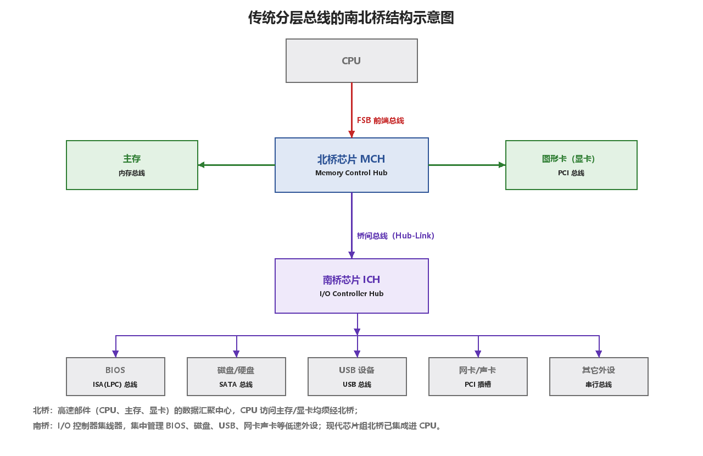

<i>图 6-1 传统南北桥总线结构</i>

### 4.总线事务

总线事务：主设备与从设备之间完成一次完整的信息交换为一个总线十五

包含三个基本阶段

①地址传送阶段：之设备将目标地址和操作类型通过总线传送给设备

②从设备相应阶段（数据准备阶段）：从设备根据地址准备数据

③数据传送阶段：完成实际数据在总线上的传输

总线上连续数据的传输

①突发传输（猝发传输）：主设备只需发送数据块的首地址，后续地址由**【硬件自动递增生成】**，无需重复使用地址线

②非突发传输

串行传输与并行传输：数据在总线上的物理传输

①串行传输：仅使用一条双向线路或两条单向线路**【接收/发送各一条】**，适合长距离通信$USB\text{、}SATA\text{、}PCIe$

根据收发双方的时序协调方式进一步分为

同步串行通信：由发送方时钟直接控制接收方时钟实现位同步，**【仅在数据块首尾添加开始和结束标记】**

异步串行通信：收发双方使用独立时钟。**【每个字符独立传输】**，通过起始位表示开始（逻辑0），结束位结束（逻辑1）】。线路空闲→保持逻辑1.发送完数据位可选择性的发送一位奇偶校验位，再发送停止位

②并行传输方式：利用多条数据线同时传送多个比特，通常单周期完成一个子的传输【早期$PCI\text{、}$内存总线】

> **⚠️ 【易错辨析】**  
> 一次总线事务含三个阶段：地址传送阶段、从设备响应（数据准备）阶段、数据传送阶段，顺序不能乱  
> 突发（猝发）传输只需发送数据块首地址，后续地址由硬件自动递增，不必每次都送地址；非突发传输每次都要重新送地址  
> 串行传输用一两条线、适合长距离（USB、SATA、PCIe）；并行传输用多条数据线同时传多位、通常单周期传一个字（早期 PCI、内存总线）  

> **📝 【补充】**  
> 异步串行以起始位（逻辑 0）表示开始、停止位（逻辑 1）结束，线路空闲保持逻辑 1，可在数据位后加奇偶校验位  

### 5.总线定时

本质是一种时序规则

①同步定时方式**【适用于总线长度较短+所有部件存取时间相近的系统】**

采用系统统一的时钟信号。每个事件间隔构成一个总线周期，每次数据传送在一个总线周期内完成

②异步定时方式**【适用于连接速度差异大+可靠性差的】**

通过主从设备之间的握手信号实现→主设备发出请求信号、从设备发出回答信号

不互锁方式：主设备发送请求后，在预设时延${t}_{1}$后自行撤销；从设备收到请求后，在预设时延${t}_{2}$后自行撤销

半互锁方式：主设备必须收到回答才撤销请求**【主设备存在互锁】**，从设备不存在互锁

全互锁方式：双方均需要收到对方的确认应答才撤销**【双方均存在互锁】**

③半同步定时方式**【适用于速度差异大+性能要求不高的系统】**

结合了同步与异步的优点，地址、命令、数据的发送参照系统时钟前沿，接收方通常在时钟后沿进行识别；【增设一条$Wait$信号线】，允许**【慢速从设备反馈准备状态】**，主设备在时钟上升沿检测，若【$Wait$无效→高电平】，表示数据未就绪，主设备插入等待周期

④分离式定时方式**【适用于多主设备竞争激烈且从设备响应延迟较大的高性能系统】**

将一个总线事务拆分成两个独立的子阶段：请求阶段、应答阶段**【两个阶段之间释放送总线】**

**【除了该方式，其它均为独占式事务模型】**→从主设备发起请求到传送结束，总线全程被该事务独占

请求阶段：主设备$A$获得总线使用权，发送完地址和命令后立即释放总线

应答阶段：从设备准备好数据后，主动申请总线，作为“主设备”发送数据

> **📌 【考点考频】**  
> 同步、异步、半同步、分离式四种定时方式的特点与适用场景，以及不/半/全互锁握手，是选择题高频点  

> **⚠️ 【易错辨析】**  
> 同步定时用统一时钟、适用于总线短且各部件速度相近；异步定时靠请求/回答握手、适用于速度差异大的系统  
> 三种互锁的区别：不互锁双方都不等待、各自延时撤销；半互锁主设备收到回答才撤请求（主互锁）、从设备不互锁；全互锁双方都等对方确认才撤销  
> 半同步增设一条 Wait 信号线，主设备在时钟上升沿检测，Wait 为高电平（无效）表示数据未就绪、插入等待周期  
> 分离式把一个事务拆成请求、应答两个独立子阶段，两阶段之间释放总线；除分离式外，其余定时方式都是独占式事务模型  

> **📝 【补充】**  
> 分离式中从设备准备好数据后要重新申请总线、并作为“主设备”发送数据，适合多主设备竞争激烈、从设备延迟大的高性能系统  

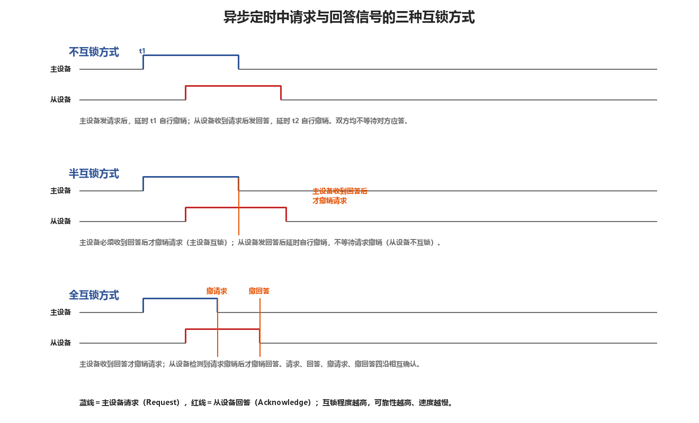

<i>图 6-2 异步定时三种握手互锁的时序</i>

### 6.总线竞争

多个主设备同时请求总线，发生总线竞争→系统配置**【总线仲裁部件】**

> **⚠️ 【易错辨析】**  
> 多个主设备同时请求总线时发生竞争，由系统配置的总线仲裁部件裁决；只有主设备能发起总线事务、从设备只能被动响应  

> **📝 【补充】**  
> 获得总线控制权的设备在本次事务期间成为主设备，事务结束后释放总线  

# 第七章 输入/输出系统

### 1.I/O接口的主要功能

①地址译码与设备选择：$CPU$发出$I/O$操作请求时，会同时提供目标外设的地址码

②通信联络与时序协调：通过握手哦信号或状态轮询机制，协调时序

③数据缓冲：解决速度不匹配问题

④信号格式转换：电平转换、串/并行转换、数/模转换等

⑤控制命令与状态信息传递：外设主动通知$CPU$时，$I/O$接口向$CPU$发出中断请求

> **📌 【考点考频】**  
> I/O 接口功能、端口编址、三种 I/O 方式几乎每年都在选择题出现，中断与 DMA 还可结合出大题  

> **⚠️ 【易错辨析】**  
> I/O 接口的功能：地址译码与设备选择、通信联络与时序协调、数据缓冲、信号格式转换、控制命令与状态信息传递（含中断请求）  
> 数据缓冲的作用是解决 CPU 与外设之间的速度不匹配；信号格式转换包括电平转换、串/并转换、数/模转换  

> **📝 【补充】**  
> 外设要主动通知 CPU 时，由 I/O 接口向 CPU 发出中断请求  

### 2.I/O接口的基本结构

内部主要包括三类寄存器：数据缓冲寄存器、状态寄存器→记录**【接口与外设】**的状态、控制寄存器→保存【$CPU$发送给外设的控制命令】

【状态寄存器仅被$CPU$读取】，【控制寄存器仅被$CPU$写入】，二者的访问方向相反且访问时间错开，因此状态寄存器和控制寄存器**【可复用同意端口地址】**→读操作访问状态，写操作访问控制

$I/O$接口中的$I/O$控制逻辑功能【对寄存器的访问通过$I/O$指令完成，属于特权指令】

①对控制寄存器中的命令字进行译码，并生成控制信号**【经过外设界面控制逻辑】**送至外设

②输出时，将数据缓冲该寄存器的内容发送给外设；输入时将外设的数据接入数据缓冲寄存器

③实时采集外设状态并更新至状态寄存器

> **⚠️ 【易错辨析】**  
> 接口含三类寄存器：数据缓冲寄存器、状态寄存器（记录接口与外设的状态）、控制寄存器（保存 CPU 发给外设的控制命令）  
> 状态寄存器仅被 CPU 读、控制寄存器仅被 CPU 写，二者访问方向相反、时间错开，因此可复用同一个端口地址（读访问状态、写访问控制）  
> 对接口寄存器的访问通过 I/O 指令完成，属于特权指令；I/O 控制逻辑负责命令译码、外设数据收发并实时采集状态更新状态寄存器  

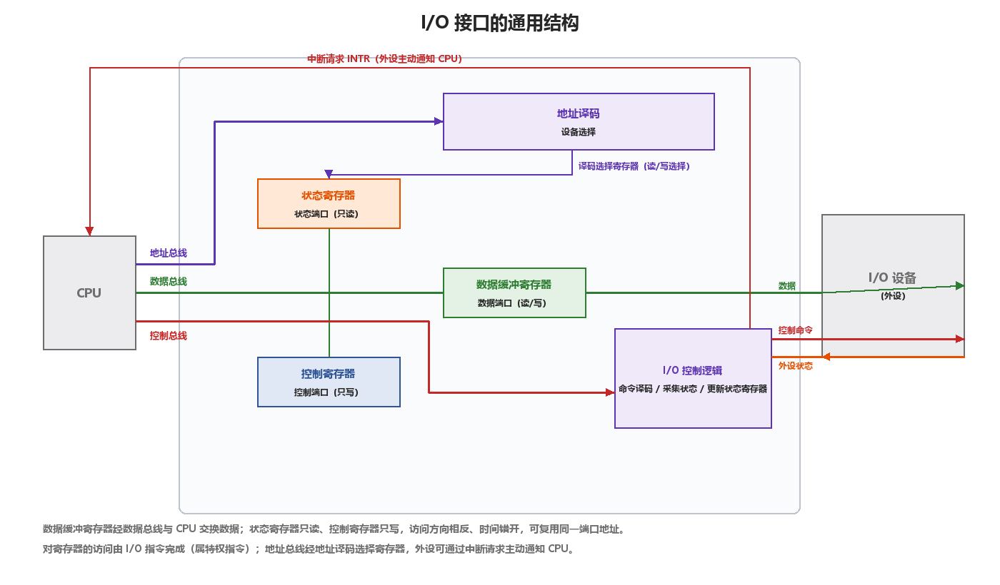

<i>图 7-1 I/O 接口的通用结构</i>

### 3.I/O接口类型

①并行接口、串行接口→指的时外设与接口一侧的数据传输

②程序查询接口、中断接口、$DMA$接口等

③可编程接口、不可编程接口→是否可通过变成改变接口功能

> **⚠️ 【易错辨析】**  
> 并行/串行接口指的是外设与接口一侧的数据传输方式；按控制方式分程序查询、中断、DMA 接口；按能否编程改变功能分可编程/不可编程接口  

> **📝 【补充】**  
> 分类依据不同，同一个接口可同时属于多种类型，注意题干问的是哪一种分类维度  

### 4.I/O端口及编址

$I/O$端口→$I/O$电路中能被$CPU$直接访问的寄存器

数据端口**【支持读/写】**、控制端口**【支持写】**、状态端口**【支持读】**

①独立编址（$I/O$映射方式）

为$I/O$端口建立一个【独立于主存的地址空间，$I/O$端口的地址和内存地址逻辑上完全分离】。$CPU$通过专用的$I/O$指令（属于特权指令）访问

$CPU$需要同时提供存储器读写、$I/O$读写两组控制信号

②统一编址（存储器映射方式）

将部分贮存地址空间分配给$I/O$端口，【通过地址范围区分，无需专用$I/O$指令】，$CPU$仅提供普通的访存指令即可访问，**【减少了系统可用内存容量】**

> **⭐ 【大题考点】**  
> 独立编址与统一编址的对比、所需指令与控制信号是选择题高频，也可结合地址范围小计算  

> **⚠️ 【易错辨析】**  
> 独立编址（I/O 映射）为端口建立独立于主存的地址空间，需要专用 I/O 指令，CPU 要同时提供存储器读写和 I/O 读写两组控制信号  
> 统一编址（存储器映射）把部分主存地址空间分配给端口，用普通访存指令即可访问、无需专用 I/O 指令，但会减少系统可用内存容量  
> 端口类型：数据端口支持读/写、控制端口支持写、状态端口支持读  

### 5.I/O方式

①程序查询方式【$CPU$与外设串行工作】

数据交换的控制完全由$CPU$完成

接口电路包括一个**【数据缓冲寄存器】**和一个**【设备状态寄存器】**

分为两类

独占查询→一旦启动外设，$CPU$不断查询外设【$CPU$忙等】

定时查询→$CPU$以固定的时间间隔周期性检查外设状态

②程序中断方式【$CPU$与外设并行工作】

支持人机交互、处理硬件故障及软件异常、支持**【多道程序与分时操作系统的任务切换】**、满足实时系统的快速响应需求、实现用户程序向操作系统的切换**【操作系统状态转换】**、多处理器系统中协调各处理器的通信与任务迁移

**【高速外设不适合直接使用单子中断方式，可能会导致数据丢失】**

程序中断的工作流程

中断请求：中断系统为每个中断源设置一个中断请求标志触发器，由触发器组成中断请求标记寄存器【可集成到$CPU$内部，也可分散在各中断源中】

$INTR$→可屏蔽中断**【优先级低】**、$NMI$→不可屏蔽中断**【优先级最高】**

中断响应判优：$CPU$处理多个同时发生的中断请求的先后顺序，由**【硬件排队器或中断查询程序实现】**

不可屏蔽$\gt $可屏蔽、高速设备$\gt $低速设备、输入设备$\gt $输出设备、实时设备$\gt $普通设备

处理优先级可通过中断屏蔽技术动态调整以支持多重中断（中断嵌套）

$CPU$响应中断的条件

存在有效中断请求、$CPU$处于开中断**【异常和不可屏蔽中断不受影响】**、当前指令一执行完成**【异常不受影响】**，且无更高优先级任务处理

中断响应过程

$CPU$响应中断后，硬件自动完成一系列操作**【中断隐指令】**，随后转入中断服务程序

中断隐指令：关中断→保存断点（$PC\text{、}PSW$的值）→引出中断服务程序**【中断服务程序寻址】**

中断嵌套的典型处理流程**【仅执行中断服务程序前后比单重多了开/关中断操作】**

关中断→保存断点→中断服务程序寻址→保存现场和**【中断屏蔽字】**→**【开中断】**→执行中断服务程序→**【关中断】**→恢复现场和中断屏蔽字→开中断→中断返回

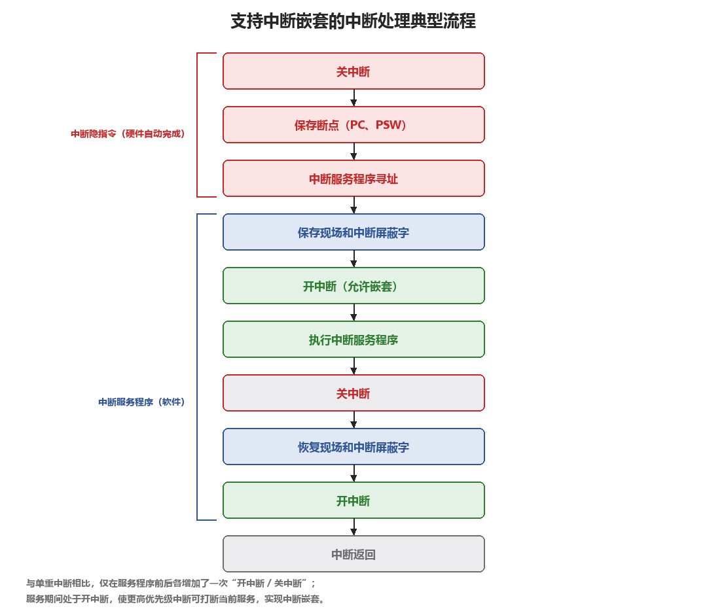

<i>图 7-2 支持中断嵌套的典型处理流程</i>

中断屏蔽技术

来自外设的中断请求信号被记录在中断请求寄存器中

中断请求寄存器的每一位对应一个中断源→为1时屏蔽对应中断

在送入中断判优电路前，每个中断请求信号会与**【对应屏蔽位的按位取反】**进行**【逻辑与】**

中断屏蔽字通常在进入中断服务程序时由软件加载

【中断屏蔽仅在$CPU$执行中断服务程序器件生效】

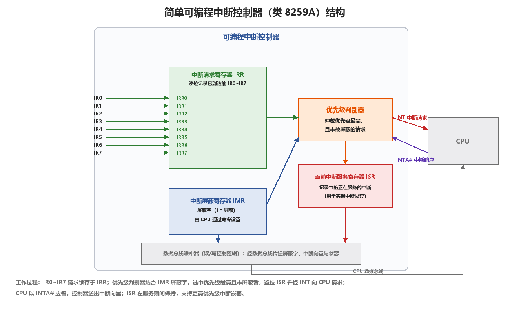

<i>图 7-3 简单可编程中断控制器（类 8259A）结构</i>

中断源对应的中断屏蔽字→屏蔽字为1表示当前信号不可被该信号中断

$CPU$执行程序的轨迹→硬件优先级高的先处理一小段时间，在执行服务程序前，转到在中断处理优先级高的程序，每次处理完一个中断都要返回主程序**【以图例学习】**

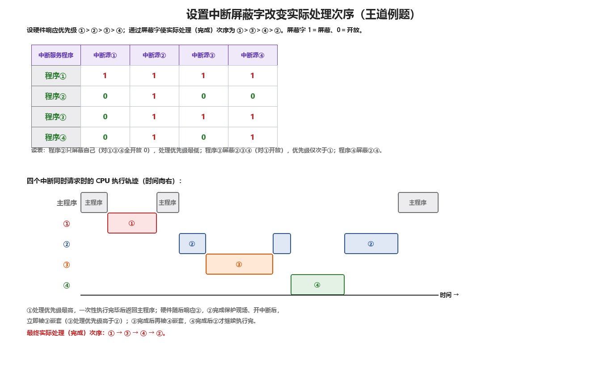

<i>图 7-4 设置中断屏蔽字改变实际处理次序及 CPU 执行轨迹</i>

③$DMA$方式**【适用于大批利郎数据传输，中断请求处理故障及传输完成通知】**

【每次$DMA$请求传输一块数据，传送周期中$DMA$与主存以字为单位，与外设以字/字节为单位】

完全由硬件控制的数据传输方法，在外设和内存之间建立了一条直接数据通路，信息传送无需经过$CPU$，避免了保存于恢复$CPU$现场等复杂操作

每次传输一个数据块，且传输该数据块的过程，主存地址的生成与传送字数的计数由硬件自动完成、主存需要设置专用缓冲区

**【传输开始前由软件进行预处理，结束后通过中断机制完成后处理】**

$DMA$控制器的组成

$DMA$控制器向$CPU$发送$DMA$请求，$CPU$响应后让出系统总线，$DMA$控制器接管总线执行数据传送，每次传输一个数据块

主存地址计数器：存放带传送数据的村驻村地址，传送前保存整批数据的起始地址，**【每传送一个字则内容自动+1】**

传送长度计数器：记录带传送数据的总长度，每传送一个字则内容自动-1，为0时表示传送结束

数据换缓冲寄存器：暂存每次传送的数据

控制/状态逻辑：设定传送方向、更新传送参数，协调$DMA$请求与$CPU$响应信号

终端机构，当一批数据传送完毕后，触发中断并向$CPU$发出中断请求

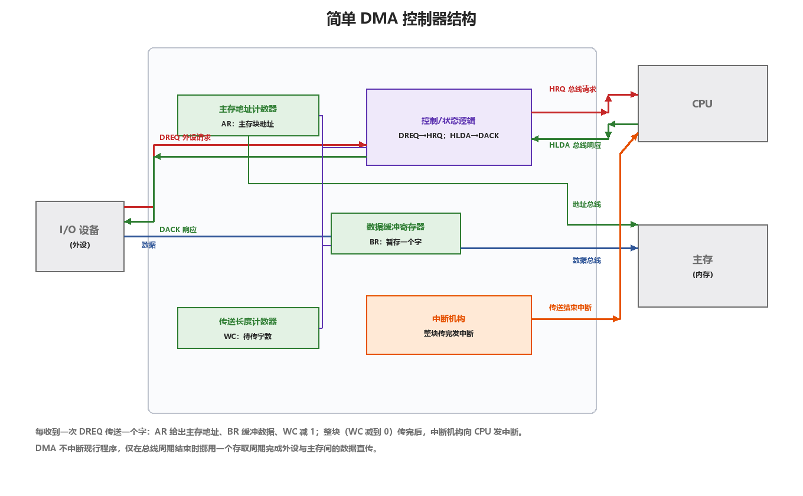

<i>图 7-5 简单 DMA 控制器结构</i>

$DMA$传送方式

$DMA$与$CPU$的三种主存共享方式

暂停$CPU$访存：适用于数据传输速率很高的$I/O$设备进行成组数据的传输

$CPU$会放弃总线并暂停访存【$DMA$访存期间$CPU$空闲】

周期挪用

允许$I/O$设备挪用一个主存存储周期，传送玩一个数据字后立即释放总线→**【单字传送方式】**

$I/O$发起$DMA$请求时，可能出现三种情况

$CPU$当前不在访存→无冲突直接使用

$CPU$正在访存→等待当前存储周期结束再释放总线

$I/O$与$CPU$同时请求访存→发生冲突，【$CPU$暂时放弃总线控制权】

$DMA$与$CPU$交替访存【适用于$CPU$工作周期长于贮存存储周期的场景】

将$CPU$工作周期划分为两个子周期，一个供$CPU$访存，一个供$DMA$访存

$DMA$的传送过程

预处理：$CPU$完成必要的初始化工作→设置$DMA$控制器中的贮存起始地址】、传送方向、传送数据个数，并启动$I/O$设备。【之后$CPU$执行原程序】

当$I/O$设备准备好待发送/接收数据时，向$DMA$控制器发出$DMA$请求，$DMA$控制器向$CPU$发出总线请求

【$DMA$请求：$I/O$外设→$DMA$控制器】、【总线请求：$DMA$控制器→$CPU$】

数据处理

$DMA$以数据块为单位进行传送，此过程有硬件自动完成，无需$CPU$干预

后处理

数据块传送完成后，$DMA$控制器向$CPU$发出中断请求，$CPU$响应后执行中断服务程序进行后处理工作

【中断请求：$DMA$控制器→$CPU$】

$DMA$方式的特点

$DMA$方式不中断现行程序

$DMA$请求在当前总线周期结束后立即获得响应，无需等待指令完成

$CPU$与$DMA$控制器同时访问主存时，$DMA$控制器的优先级更高

> **⭐ 【大题考点】**  
> 程序查询/程序中断/DMA 三种方式的对比、中断屏蔽字与 CPU 执行轨迹、DMA 传送过程与主存共享方式是本章大题高频点  
> 会根据中断屏蔽字推导实际处理次序并画 CPU 轨迹：硬件优先级高的先执行保护现场等一小段，开中断后被处理优先级更高的程序嵌套，每处理完一个都返回，最终完成次序由屏蔽字决定  

> **⚠️ 【易错辨析】**  
> 程序查询方式 CPU 与外设串行、独占查询时 CPU 忙等；接口只需一个数据缓冲寄存器和一个设备状态寄存器  
> 程序中断方式 CPU 与外设并行工作；INTR 是可屏蔽中断、优先级低，NMI 是不可屏蔽中断、优先级最高；高速外设不适合直接用单字中断，否则可能丢失数据  
> 判优次序：不可屏蔽＞可屏蔽、高速设备＞低速设备、输入设备＞输出设备、实时设备＞普通设备；处理优先级可通过中断屏蔽技术动态调整  
> CPU 响应中断须同时满足：存在有效中断请求、CPU 处于开中断（异常和 NMI 不受影响）、当前指令已执行完成（异常不受影响）、无更高优先级任务  
> 中断隐指令（关中断、保存断点 PC 与 PSW、引出中断服务程序）由硬件自动完成；保存现场和屏蔽字、开关中断、恢复现场、中断返回由中断服务程序（软件）完成  
> 支持嵌套的服务程序比单重中断仅在执行服务程序前后各多了一次开中断/关中断，服务期间处于开中断，才能被更高优先级中断打断  
> 屏蔽字为 1 表示当前服务程序不能被该级中断打断；每个中断请求在送入判优电路前先与对应屏蔽位的按位取反做逻辑与；屏蔽字只在 CPU 执行中断服务程序期间生效  
> DMA 完全由硬件控制，在外设与主存间建立直接数据通路、不经 CPU；每次 DMA 请求传输一块数据，与主存以字为单位、与外设以字/字节为单位  
> DMA 三种主存共享方式：暂停 CPU 访存（成组、高速设备，DMA 期间 CPU 空闲）、周期挪用（单字传送、挪用一个存储周期后释放）、CPU 与 DMA 交替访存（CPU 周期长于存储周期时各用一个子周期）  
> DMA 不中断现行程序，在总线周期结束后立即响应（无需等指令完成）；CPU 与 DMA 同时请求访存时 DMA 优先级更高  

> **📝 【补充】**  
> DMA 预处理由 CPU 完成初始化（主存起始地址、传送方向、数据个数并启动外设），之后 CPU 执行原程序；数据处理阶段由硬件完成、无需 CPU 干预；后处理在整块传完后由 DMA 发中断、CPU 执行中断服务程序  
> 中断控制器（如 8259A）由中断请求寄存器 IRR、中断屏蔽寄存器 IMR、优先级判别器、当前中断服务寄存器 ISR 和数据总线缓冲器组成，ISR 在服务期间保持以支持嵌套
